

# Martlet

### Meet your AI companion. She talks, listens, plays along and lives right on your desktop.

&nbsp;

[Things to say](#-things-you-can-say) · [Screenshots](#-take-a-look) · [Get started](#-up-and-running-in-minutes) · [Everything she can do](#-everything-she-can-do) · [Privacy](#-private-by-design) · [Guides](https://github.com/throndir2/Martlet/wiki)

 

<picture>
  <source media="(prefers-color-scheme: dark)" srcset="docs/images/hero-dark.png">
  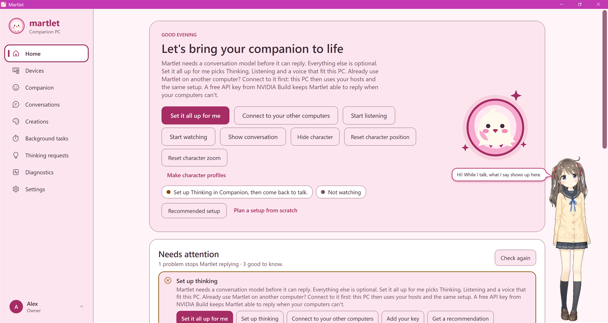
</picture>

<i>She stands on top of everything, games included, and every word she says pops up in a speech bubble.</i>

---

## 💗 Say hi to Martlet

Martlet is a friend who lives on your desktop. Talk to her or type, and she
answers out loud in the voice you chose. Her animated character stands on top
of your windows and moves her lips while she talks.

She can **watch your game with you**, **read up on the games you play**,
**remember what matters to you**, **react when you touch her**, **draw you
pictures**, **write and sing you songs**, **dim your lights** and **help out on
your PC**.

You choose where her mind runs: privately on your own PC, on a stronger
computer down the hall, spread across all your computers, or with a cloud AI
you like. Martlet is free, and no sign-up is needed.

<table>
<tr>
<td align="center" width="25%">🎙️ <b>Just talk</b> Hands-free, push-to-talk or type</td>
<td align="center" width="25%">✨ <b>She's alive</b> A character with lip-sync, emotions and touch</td>
<td align="center" width="25%">🔒 <b>Yours</b> Runs on your own PCs, no sign-up</td>
<td align="center" width="25%">🖥️ <b>Everywhere</b> The same Martlet on all your computers</td>
</tr>
</table>

## 💬 Things you can say

| You say | Martlet |
| --- | --- |
| 🎮 *"Ugh, this boss again. Any ideas?"* | Press **Start watching** and she glances at your screen now and then. She joins in like a friend on the couch, and stays quiet the rest of the time. |
| 📚 *"Where do I find iron ore?"* | With **App guides** on, she answers from the fan wiki of the game in front of you. New game? She reads up on it on her own and tells you. |
| 🎨 *"Draw me a fox curled up in the snow."* | She paints it in the background while you keep chatting, then shows it to you and saves it in **Creations**. |
| 🎤 *"Write a song about rainy Sundays and sing it for me."* | She writes the lyrics and the music, then sings it in the voice you chose. |
| 💭 *"Can you plan a week of dinners? Take your time."* | She thinks it over in the background while you keep talking, and brings it up when it's ready. |
| 🧠 *"What did we talk about yesterday?"* | She remembers what matters to you and finds earlier conversations, all kept on your own computers. |
| ⏰ *"Remind me to stretch at three."* | She reminds you on the computer you used last. |
| 🏠 *"Turn the living room lights down."* | Connect her to Home Assistant and your smart home answers to her voice. |
| 🖥️ *"How much space is left on my D: drive?"* | Give her tools and she helps on your PC. She asks before she does anything. |
| 🤗 *(Pat her on the head.)* | She leans in, smiles and maybe says something about it, true to her personality. |

## 📸 Take a look

<table>
<tr>
<td width="50%">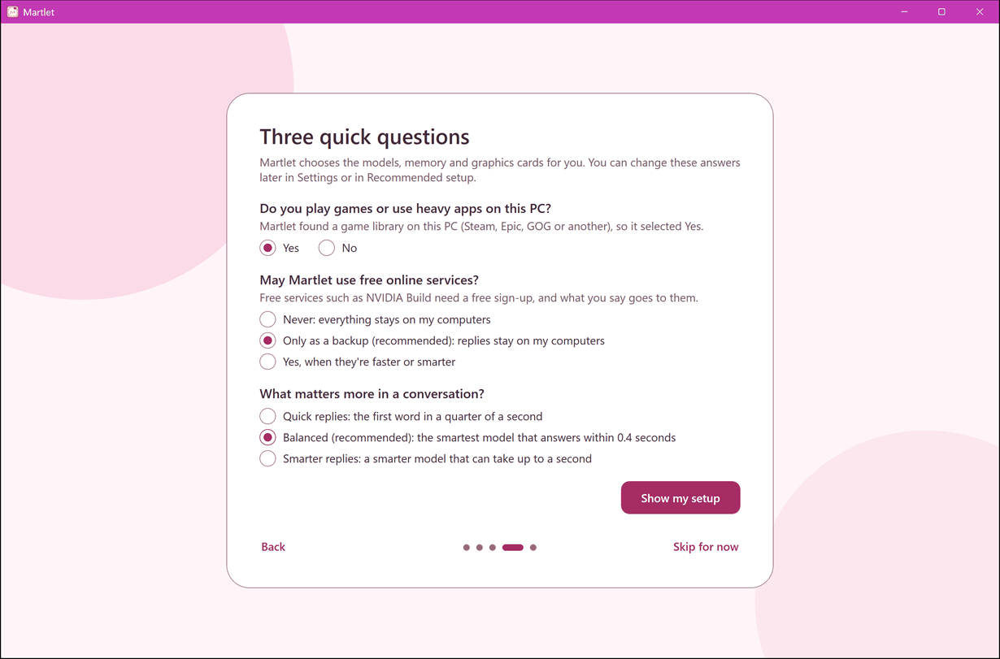
<b>A warm welcome</b> Three quick questions plan a setup that fits your PC.
</td>
<td width="50%">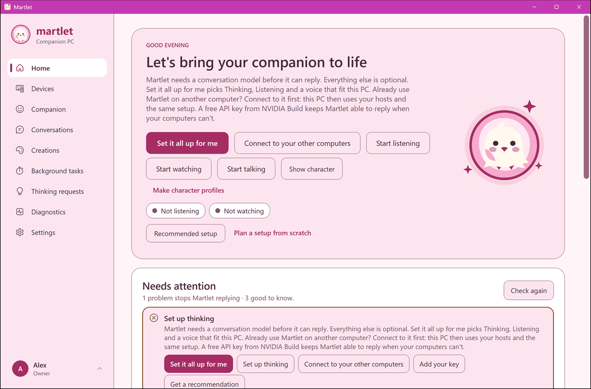
<b>Home</b> Talk, listen or watch in one click. Home tells you what needs attention.
</td>
</tr>
<tr>
<td align="center">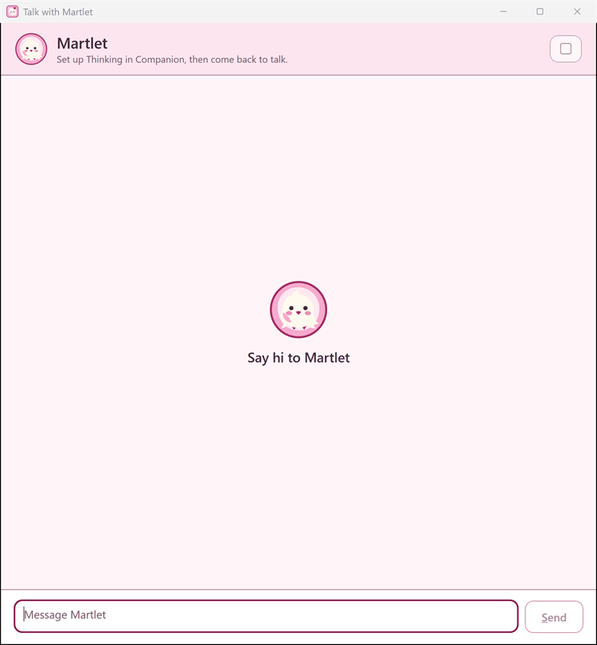
<b>Talk window</b> A simple chat that stays out of your way.
</td>
<td align="center">
<picture>
  <source media="(prefers-color-scheme: dark)" srcset="docs/images/character-bubble-dark.png">
  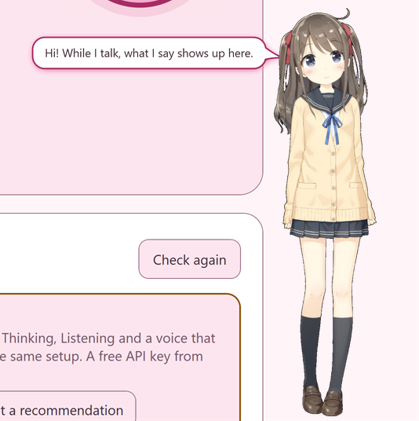
</picture>

<b>Always by your side</b> Speech bubbles follow her wherever you put her.
</td>
</tr>
<tr>
<td>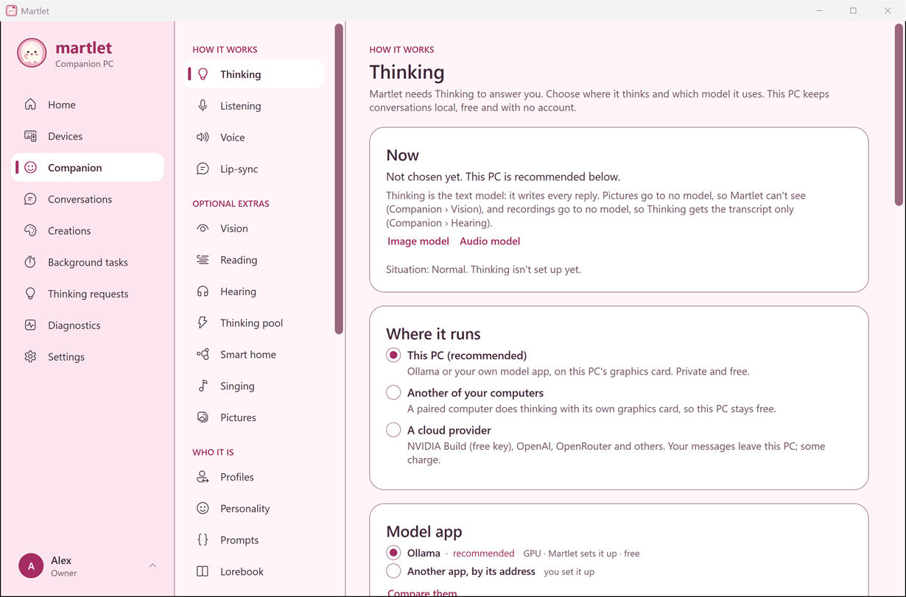
<b>Your PC, your choice</b> Think on this PC, on another computer or in the cloud.
</td>
<td>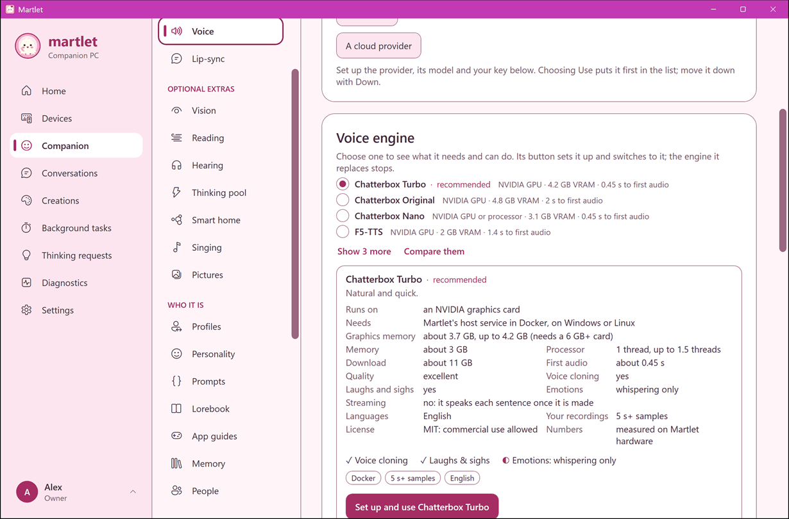
<b>Pick her voice</b> See what each voice needs and can do, then set it up in one click.
</td>
</tr>
<tr>
<td>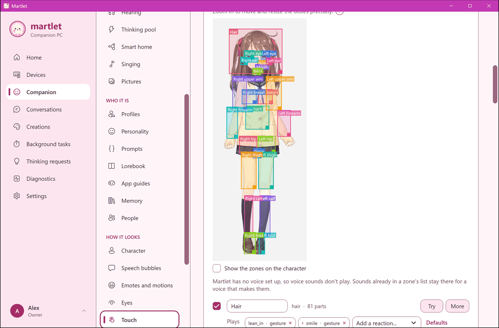
<b>She feels your touch</b> Martlet finds the touch zones on her body for you.
</td>
<td>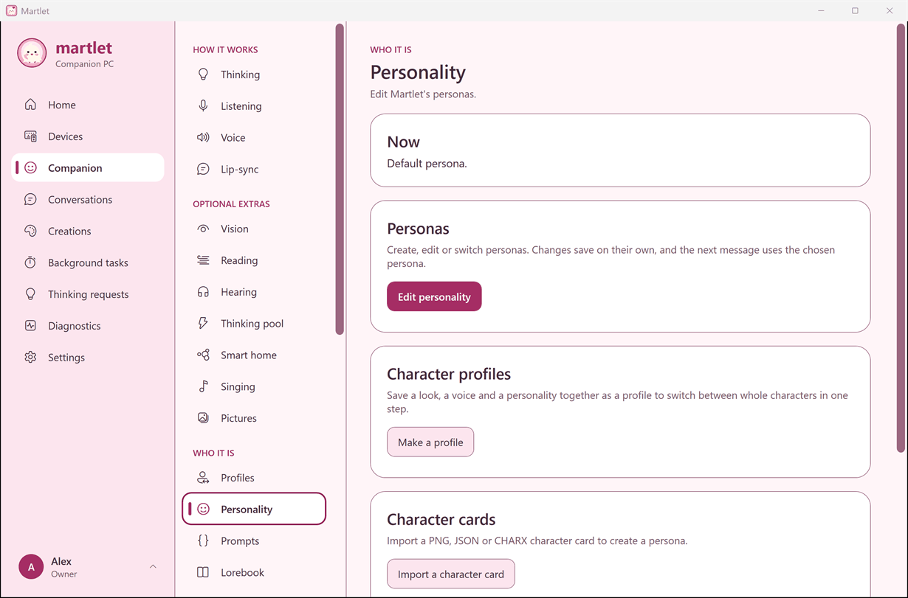
<b>Her personality</b> Personas, profiles and character cards.
</td>
</tr>
<tr>
<td>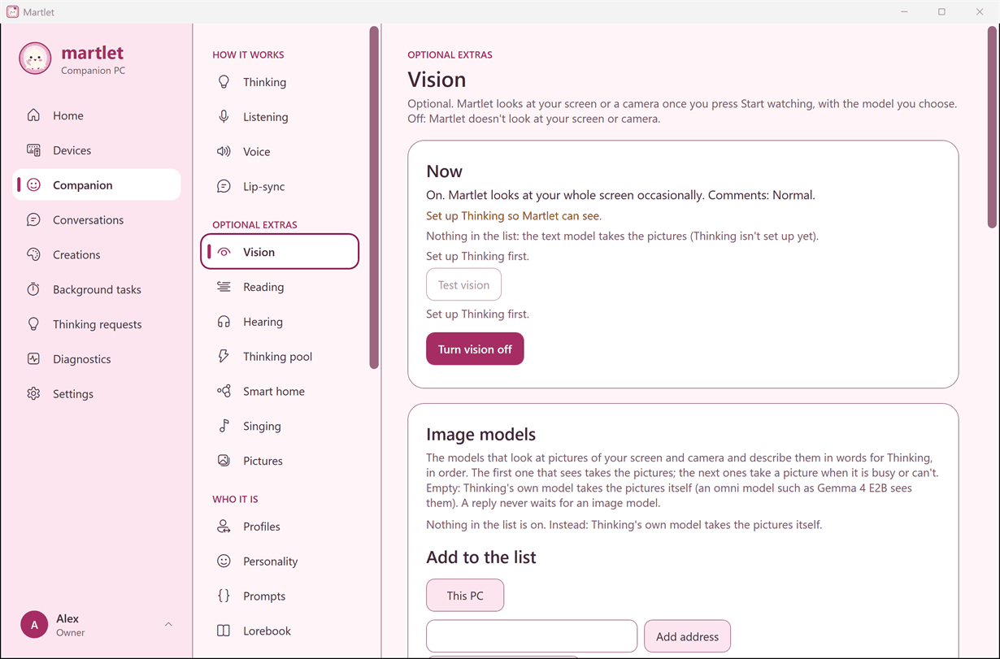
<b>She sees what you see</b> Your screen, the window you use or a camera.
</td>
<td>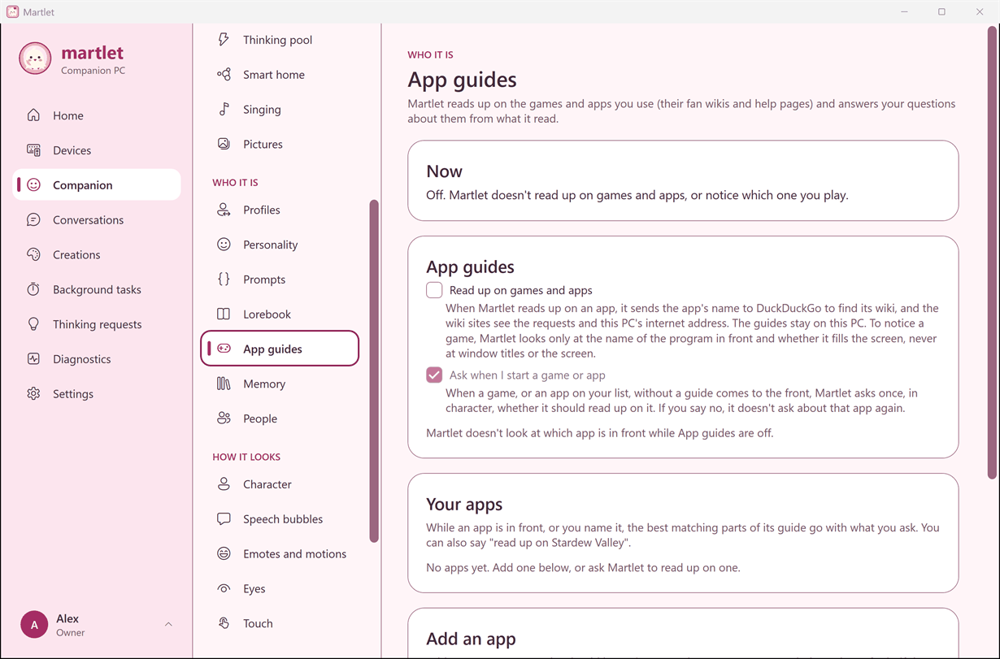
<b>App guides</b> She reads up on the games and apps you use.
</td>
</tr>
<tr>
<td>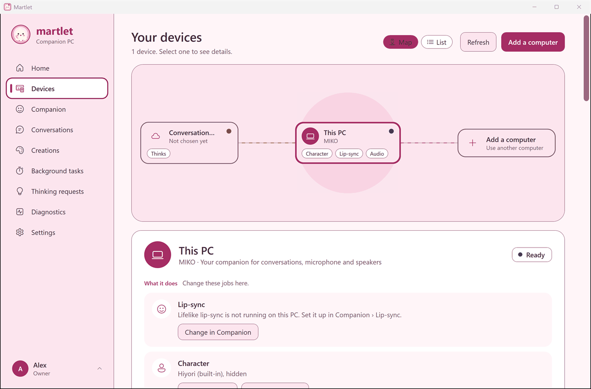
<b>All your computers</b> See what each computer does and how much it uses.
</td>
<td>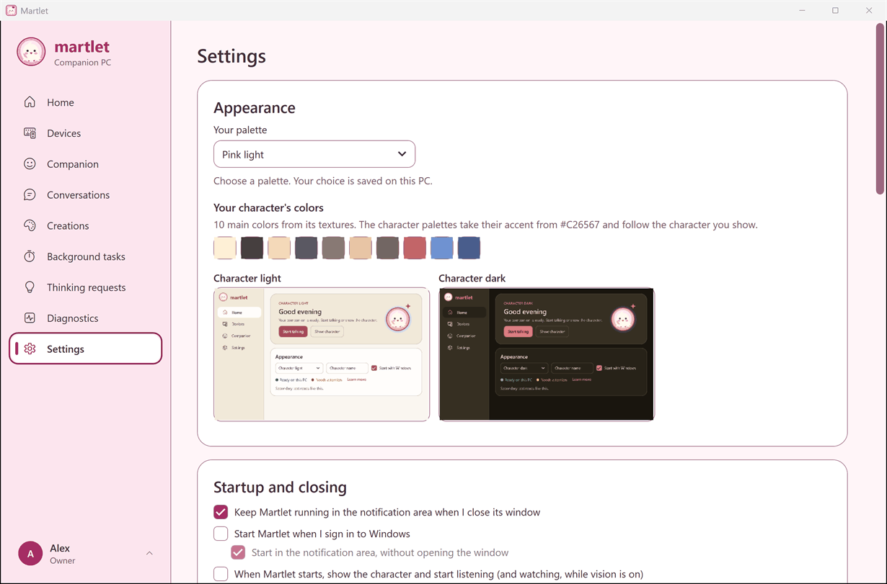
<b>Make it pretty</b> Themes that can match your character.
</td>
</tr>
</table>

## 🚀 Up and running in minutes

1. **[Download Martlet](https://github.com/throndir2/Martlet/releases/latest)**
   (`Martlet-<version>-win-x64.exe`) and run it. You don't need
   administrator rights.
2. **Follow the welcome tour.** Start a new Martlet network, or join the one
   on your other computers. Answer three quick questions: do you play games
   on this PC, may Martlet use free online services, and do quick or smarter
   replies matter more?
3. **Choose Use these suggestions.** Martlet picks what fits your PC and
   installs it after one confirmation: a model for **thinking**, your
   microphone for **listening**, and a **voice**.
4. **Press Start talking or Start listening, then Show character.** Say hi! 👋

Want something different? Every part is on the **Companion** page. On Home,
**Recommended setup** makes the best use of all your computers, and it tells
you when a better setup is available.

### What you need

| You need | |
| --- | --- |
| 🪟 **Windows** | Windows 10 (version 2004 or later) or Windows 11, 64-bit. Windows 11 on Arm PCs, such as Snapdragon X laptops, work through Windows' x64 emulation. |
| 🎮 **Graphics card** | Optional. Any PC works with a cloud provider. A graphics card runs AI models on your own PC. Picture making, singing, Audio2Face and most cloned voices need an NVIDIA card, but Chatterbox Nano gives a cloned voice even on the processor. |
| 🌐 **Internet** | To download models and to use cloud services. With a setup on your own computers, your conversations stay on them. |
| 💸 **Cost** | Martlet is free. Cloud providers can charge for use; Martlet walks you through free keys for NVIDIA Build and Google Gemini. |

> [!NOTE]
> The installer isn't code-signed, so Windows may ask you to confirm before it
> runs. Updates install in the background later, and you choose when Martlet
> restarts into them.

<b>🐧 Linux and 🍎 Mac (early desktop companion)</b>

 

Each release also has `Martlet-<version>-linux-x64.AppImage` and
`martlet_<version>_amd64.deb` (and `arm64` versions), and
`Martlet-<version>-macos-arm64.dmg` (Apple silicon) and `-macos-x64.dmg`
(Intel, macOS 14 or later). The early app lets you type or hold a key to
talk, hear the replies and see your character on top of your windows.

- On Ubuntu or Debian, run `sudo apt install ./martlet_<version>_amd64.deb`.
- The AppImage needs WebKitGTK 4.1 and libsecret.
- The Mac app isn't notarized. The first time, choose **Done**, then
  **System Settings > Privacy & Security > Open Anyway**.

Linux computers and Macs can also be hosts that lend their power to your
other computers. See [Linux and macOS](docs/DESKTOP_LINUX_MACOS.md#installers-part-of-the-release-build).

## 🆕 What's new in 0.76.0

- 👀 **Choose how often Martlet reads your screen**: Companion › Reading › **Read the screen** goes up to twice a second, so a new score or message reaches Martlet much sooner.
- ⚡ **PP-OCRv5 mobile on a graphics card**: a computer with an NVIDIA graphics card can run the recommended reading model there, much faster than on the processor. It stays optional.
- 🔎 **Martlet finds things by meaning, not only by words**: memories, game guides and research reports that say the same thing in other words are found too.
- 🌍 **More languages when Martlet remembers**: memory, app guides and earlier conversations now find matches in Spanish, French, German, Portuguese, Italian, Chinese, Japanese and Korean.
- 🧠 **A memory that keeps itself tidy**: Martlet keeps a short profile of you, keeps what used to be true as history, and merges facts that say the same thing in the background.

[Full changelog](CHANGELOG.md) · [All releases](https://github.com/throndir2/Martlet/releases)

## 🌸 Everything she can do

Pick an area to jump to it. Each area has a short summary, a folded list with
everything in it, and links to its guides.

<table>
<tr>
<td align="center" width="25%"><a href="#-talk-naturally">💬 <b>Talk naturally</b></a></td>
<td align="center" width="25%"><a href="#-any-voice-you-like">🎤 <b>Any voice you like</b></a></td>
<td align="center" width="25%"><a href="#-a-character-on-your-desktop">✨ <b>A character on your desktop</b></a></td>
<td align="center" width="25%"><a href="#-she-feels-your-touch">🤗 <b>She feels your touch</b></a></td>
</tr>
<tr>
<td align="center"><a href="#-plays-along-with-you">👀 <b>Plays along with you</b></a></td>
<td align="center"><a href="#-remembers-you">🧠 <b>Remembers you</b></a></td>
<td align="center"><a href="#-make-her-your-own">🎭 <b>Make her your own</b></a></td>
<td align="center"><a href="#-smart-your-way">💭 <b>Smart, your way</b></a></td>
</tr>
<tr>
<td align="center"><a href="#-a-mind-of-her-own">🔔 <b>A mind of her own</b></a></td>
<td align="center"><a href="#-creative-side">🎨 <b>Creative side</b></a></td>
<td align="center"><a href="#-helps-around-your-pc-and-home">🧰 <b>Helps around your PC and home</b></a></td>
<td align="center"><a href="#-chat-from-anywhere">📱 <b>Chat from anywhere</b></a></td>
</tr>
<tr>
<td align="center"><a href="#-one-martlet-all-your-computers">💻 <b>One Martlet, all your computers</b></a></td>
<td align="center"><a href="#-made-for-the-whole-household">🏡 <b>Made for the whole household</b></a></td>
<td align="center"><a href="#-your-ai-assistant-can-set-her-up">🤖 <b>Your AI assistant can set her up</b></a></td>
<td align="center"><a href="#-and-all-the-little-things">🎀 <b>And all the little things</b></a></td>
</tr>
</table>

### 💬 Talk naturally

Talk hands-free, hold a key or type. She answers out loud within moments,
waits until you have finished and stops when you talk over her.

Everything in <b>Talk naturally</b>

- Press **Start listening** to talk hands-free, or hold the talk button (or Space) to talk. Nothing listens until you press a button.
- Prefer typing? The **talk window** is a simple chat that sits beside your work.
- She hears when you have finished a sentence. She answers sooner when you're clearly done and waits when you trail off.
- She starts on her reply in the short pause after you speak, so it's ready the moment your turn ends.
- Replies are spoken sentence by sentence and start with a few quick words, so her voice starts before the whole reply is written.
- When a reply is slow to start, she says a quick "Mm," or "Hmm..." in her own voice, so you're never left in silence.
- Talk over her and she pauses at once. Words meant for her stop the reply; a "yeah", a laugh or the TV lets her carry on where she stopped.
- When you cut her off, she remembers only what she actually said aloud.
- **Voice ID** knows your voice and ignores other people talking. **People** learns the voices in your home and the names they go by.
- She treats voices around you as context, and answers someone in your call or room who clearly talks to her.
- Speech recognition runs inside Martlet with Parakeet (up to 25 languages), or uses Whisper, OpenAI or Windows speech. If the computer that listens goes away, Parakeet on this PC takes over.
- Press **Stop** or Esc to stop a reply at any time.

📖 [Talking to Martlet](https://github.com/throndir2/Martlet/wiki/Talking-to-Martlet) · [Listening and Voice ID](https://github.com/throndir2/Martlet/wiki/Listening-and-Voice-ID)

### 🎤 Any voice you like

Pick a ready-made voice or clone one from a few seconds of audio. Her voices
can laugh, sigh and whisper.

Everything in <b>Any voice you like</b>

- Seven voice engines run on your own computers: **Chatterbox Turbo**, **Chatterbox Original**, **Chatterbox Nano**, **F5-TTS**, **XTTS-v2**, **GPT-SoVITS** and **Dia**.
- Or use **Windows** voices, **OpenAI** voices or **ElevenLabs**, which copies one of your saved voices and can whisper or sound happy, sad or angry.
- **Clone a voice** from one or more recordings. Most audio and video files work, and Martlet writes the transcript for you. No training is needed.
- **Record your own voice**: read four short lines out loud, and Martlet makes a voice from yours.
- Six starter voices are ready to use, led by the natural, cheerful **Jenny (Dioco)** and two cute, bubbly voices.
- Expressive voices laugh, sigh, gasp and whisper when the moment calls for it. Chatterbox Original chooses calm or dramatic for each sentence.
- Chatterbox Nano runs on a small graphics card or on the processor, so every PC can have a cloned voice.
- **Compare them** shows the voices side by side: what each can copy, whether it laughs, its languages, its memory use and its license.
- Your voices are on all your computers, and a volume control sets how loud she talks and sings.

📖 [Voices](https://github.com/throndir2/Martlet/wiki/Voices)

### ✨ A character on your desktop

A Live2D or VRM character stands on your desktop, over full-screen games too.
She moves her lips with her voice, shows how she feels and looks where she
wants.

Everything in <b>A character on your desktop</b>

- Start with the built-in Hiyori, then add as many **Live2D** (VTube Studio folders work too) or **VRM** characters as you like.
- Drag her anywhere, also to another monitor. Zoom her, lock her in place, or **Let clicks pass through** her while you play.
- **Speech bubbles** follow her, and **subtitles** show what she says.
- Her mouth follows her voice, or NVIDIA **Audio2Face** moves it, on this PC or on any of your computers.
- Emotes: three strengths of blush, heart eyes, star eyes, tears, sweat drops, anger veins, sparkles, steam, dizzy swirls, a sleepy Zzz and more. Martlet measures her face, so they sit in the right places.
- Gestures: she winks, pouts, acts shy, giggles, flinches, leans in for a head pat, looks away, rolls her eyes and gets drowsy.
- Looks can **stay on**, like glasses or a blush, until she turns them off. **Combos** play several at once: lovestruck, flustered, fuming, starstruck and more.
- She laughs, sighs and gasps with her body along with her voice.
- **Eyes**: she follows your mouse, looks straight ahead, watches the window you use, or lets her personality decide.
- Drag her somewhere new and she notices, and says something about it.
- Right-click her for a quick menu: talk, hide, mute, eyes, click-through and keep on top.

📖 [The Character](https://github.com/throndir2/Martlet/wiki/The-Character)

### 🤗 She feels your touch

Poke, pat, hold or stroke her. Every part of her body reacts the way her
personality would.

Everything in <b>She feels your touch</b>

- Martlet finds her **touch zones** for you: her head, cheeks and hands, tails, wings, ears and ponytails that swing, and things special to her, like a halo or a hat.
- A **touch temperament** from her personality decides what she likes, from hating it to craving it. Make your own temperaments and use them for any persona.
- Each zone plays its own list of emotes, gestures, motions and sounds, like a giggle or a gasp in her own voice.
- Stroke across her with the mouse, and each part reacts as you pass.
- Touch her while she talks and she stops to react, then decides whether to carry on.
- She has moods of her own. When she gets angry with you or warms up to you, she can change how she takes your touches for a few hours. You see each change and can **Undo** it.
- Her next reply knows how you touched her.
- Edit the zones on a picture of her that you can zoom, with several areas for each zone. **Start over** resets them.

📖 [The Character › Touch temperament](https://github.com/throndir2/Martlet/wiki/The-Character#touch-temperament)

### 👀 Plays along with you

She watches your screen or a camera, reads the text on it, hears what your PC
plays and reads up on the games you play.

Everything in <b>Plays along with you</b>

- Press **Start watching** and she glances at your **whole screen**, **the window you use**, a **webcam**, a **capture card**, your **phone's camera** or a **Home Assistant camera**. Full-screen games work too.
- You decide how chatty she is: Quiet, Normal, Chatty, or let her decide.
- She knows which app you're in and whether it's full screen, so she talks about your game or show, not its menus.
- **Reading**: she reads the text on your screen, small text included, with Windows OCR or PP-OCRv5. A new score or message makes her look.
- She knows what changed on your screen over the last moments.
- **Hearing**: she hears what your PC plays, such as music and its mood, game sounds, laughter and alarms, and knows where it comes from: a YouTube video, a Discord call or Spotify.
- She hears *how* you say things, not only the words.
- **App guides** (on by default): she reads the fan wikis and help pages of your games and apps, and answers from them. When you start a game she has no guide for, she reads up on it on her own: she looks up its name on DuckDuckGo, reads its wiki and tells you. To stop her, say no, press **Stop reading**, or turn off **Read up when I start a game or app** in Companion › App guides.
- Ask *"what do you think of this?"* and she sees what you see.
- Play on your gaming PC and she moves her thinking off its graphics card to another computer, then moves it back when you stop.
- She never looks at password managers, private browsing or her own windows. Screenshots stay in memory and are never saved.
- Using a Thinking model that only reads text? Add an image model and an audio model that tell it what they see and hear.

📖 [Vision](https://github.com/throndir2/Martlet/wiki/Vision) · [Listening › Audio model](https://github.com/throndir2/Martlet/wiki/Listening-and-Voice-ID#audio-model)

### 🧠 Remembers you

She remembers what matters to you and picks up earlier conversations. It all
stays on your own computers.

Everything in <b>Remembers you</b>

- Memory is on from the start. After each reply she keeps the lasting facts, and she knows whose each fact is.
- She finds the right memories, also with other forms of a word ("cats" finds your cat).
- In the Memory window you can see, add, edit, delete and export every memory, and choose how long they stay.
- The **Conversations** page lets you read, search, edit and delete every conversation.
- Mention an earlier talk and she finds what was said, by your words, the time you name and who said it.
- Memories follow you on all your computers, through your own computers only. There is no cloud memory service.

📖 [Memory](https://github.com/throndir2/Martlet/wiki/Memory)

### 🎭 Make her your own

Write her personality, import character cards and lorebooks, and switch her
look, voice and personality in one click.

Everything in <b>Make her your own</b>

- Write **personas** in your own words and switch between them.
- **Character profiles** switch look, voice and personality together. Each profile also remembers where she stands, how big she is and where she looks, on each computer. Switch from Home, the notification area or Companion.
- Import **SillyTavern** and **Chub** character cards (PNG, JSON and CHARX).
- **Lorebooks** work like SillyTavern World Info, and NovelAI lorebooks import too.
- Edit every prompt Martlet uses, with an estimate of its size.
- Set how long her replies are, how much of the conversation she keeps in mind, and whether a reasoning model thinks step by step before it answers.
- **Adult content (18+)** for adult characters, off by default.

📖 [Personality and Characters](https://github.com/throndir2/Martlet/wiki/Personality-and-Characters)

### 💭 Smart, your way

Run her mind free and private on your own PC, or use a cloud AI you like.
Martlet picks a model that fits.

Everything in <b>Smart, your way</b>

- **Ollama** on your PC: Martlet installs it and downloads a model that fits your graphics card. Any Ollama model works.
- Already use a model app? Martlet finds **LM Studio**, **llama.cpp**, **KoboldCpp**, **Jan**, **vLLM**, **Lemonade**, **GPT4All** and **Docker Model Runner**, and thinks with the model you already run.
- Cloud: **OpenAI**, **Google Gemini**, **OpenRouter**, **NVIDIA Build** or any OpenAI-compatible service.
- Martlet's own model list updates every day, so new models show up without a Martlet update. Each model says what it takes in (text, pictures, sound and video), how smart it is and what it needs.
- **If Thinking fails**, a backup model steps in. **Backup Thinking** asks a second model when the first one is slow to start.
- When a service retires your model, Home offers a replacement with a **Use** button.
- **Test model**, **Test tools**, **Test vision** and **Test hearing** check a model before you rely on it.

📖 [Thinking](https://github.com/throndir2/Martlet/wiki/Thinking)

### 🔔 A mind of her own

A **Thinking pool** does her background work on your other models and
computers, so replies stay fast. **Check-ins** keep her on track and let her
act on her own.

Everything in <b>A mind of her own</b>

- The Thinking pool shares background work across your models, graphics cards and computers: thinking longer, web research, screen and sound summaries, and remembering.
- Your conversation always comes first. Background work waits while you talk.
- Mark each model **Fast**, **Standard** or **Smart**, choose where each kind of job runs, and keep a machine for quick jobs or long jobs.
- A computer with several NVIDIA graphics cards can run a pool model on each one.
- Ask her to take her time and she thinks it over while you talk, then brings it up when it's ready.
- **Check-ins** run every few minutes or when something happens. She welcomes you back, follows up on a question you skipped, keeps quiet on calls, stops repeating herself and turns off emotes that no longer fit.
- **Act on what was said**: right after a reply, the pool does what she promised, like calling a Discord friend, setting a reminder or changing a memory, so her replies start sooner.
- Write your own check-ins. Choose what they know (your screen, your microphone, your touches, what was said, who is here), when they run (after a reply, a touch, a call, a notification or a script's output) and what they do, with tools.
- The **Thinking requests** page shows every job, where it ran and how long it took.

📖 [Thinking › Thinking pool](https://github.com/throndir2/Martlet/wiki/Thinking#thinking-pool) · [Check-ins](https://github.com/throndir2/Martlet/wiki/Thinking#check-ins)

### 🎨 Creative side

She paints pictures, writes and sings songs, and researches the web, all in
the background while you keep talking.

Everything in <b>Creative side</b>

- **Picture making** with ComfyUI on your computers (Z-Image Turbo), your own ComfyUI, OpenRouter or NVIDIA Build.
- **Songs**: she writes the lyrics and the music, sings in a voice you chose (with SoulX-Singer or VevoSing) and moves her lips while she sings.
- **Web research**: she looks into a question in the background and writes a report.
- Everything she makes waits for you in **Creations**. Ask her to sing a song again or to show you a picture.
- Each job goes to whichever of your computers is free.

📖 [Pictures and Creations](https://github.com/throndir2/Martlet/wiki/Pictures-and-Creations) · [Singing](https://github.com/throndir2/Martlet/wiki/Singing)

### 🧰 Helps around your PC and home

Give her tools and she helps on your PC and in your smart home. She always
asks first.

Everything in <b>Helps around your PC and home</b>

- **Tools**: browse the MCP Registry and add tool servers with a click, or paste your own.
- Before each tool call, you see exactly what it does, with **Allow once**, **Always allow this tool** and **Deny**.
- A built-in **Terminal**, off until you turn it on, asks before every command and never runs as administrator.
- **Reminders** play on the computer you used last.
- **Home Assistant**: lights, climate and more answer to her voice. Locks, doors, garage doors and alarms are blocked or need your click.
- Martlet finds, sets up, backs up and updates Home Assistant for you, and can install it on one of your Linux computers.
- The **Background tasks** page shows what she's working on.

📖 [Tools and MCP](https://github.com/throndir2/Martlet/wiki/Tools-and-MCP) · [Smart Home](https://github.com/throndir2/Martlet/wiki/Smart-Home)

### 📱 Chat from anywhere

Talk with her on Discord, Telegram and WhatsApp too.

Everything in <b>Chat from anywhere</b>

- **Discord**: a bot that chats in direct messages, channels and threads. Choose how often she joins in on each channel, and use `/martlet` and `/chatmode`.
- She joins Discord voice calls, calls you in private, and shows up on camera as her character with a background.
- She can also join the Discord calls you're already in, through your PC's sound.
- **Telegram**: pair a chat with a code. No public address is needed.
- **WhatsApp** through Meta's official Cloud API.
- These messages go into your conversation history too.

📖 [Discord](https://github.com/throndir2/Martlet/wiki/Discord) · [Telegram and WhatsApp](https://github.com/throndir2/Martlet/wiki/Telegram)

### 💻 One Martlet, all your computers

Use the same Martlet on every PC, and let your strongest computers do the
heavy work.

Everything in <b>One Martlet, all your computers</b>

- A **companion PC** is where you talk to her. A **host** lends its graphics card and processor. One PC can be both.
- Join your Martlet network in a few clicks. Martlet finds your other computers, and you check that both screens show the same number.
- **Recommended setup** plans the best use of all your computers. It keeps your gaming PC's graphics card free, uses the models you already have and tells you when a better setup is available.
- The **Devices** map shows every computer, what it does, and how much graphics memory, memory, processor and disk each part uses.
- Each job (voice, listening, lip-sync, reading, seeing, hearing, pictures and singing) has a list of machines in order. When one is busy or offline, the next one takes over.
- **Keep Martlet the same on all my computers** brings your settings, voices, characters, memories and creations to every PC.
- Hosts run on Windows (with Docker Desktop), on Linux (set up over SSH from Martlet), on Macs and on ARM64 computers such as a Raspberry Pi 5.
- **Share your hosts with friends**, and sign in from outside your home.
- Update every host from your companion PC.

📖 [Multiple Computers](https://github.com/throndir2/Martlet/wiki/Multiple-Computers) · [Setting Up a Host](https://github.com/throndir2/Martlet/wiki/Setting-Up-a-Host)

### 🏡 Made for the whole household

Everyone at home gets their own Martlet: their own characters, memories and
settings, on every computer.

Everything in <b>Made for the whole household</b>

- Martlet signs you in with your Windows account. Click your name to switch person or **Add a person**.
- Each person has their own personalities, profiles, prompts, lorebooks, theme, Voice ID, reminders, memories and creations.
- Link your voice to your account, and she knows who is talking.
- **Share a copy** of a character, or **share it together** so everyone talks to the same character, who remembers each of you.
- **Household memories** are known to every character. Copy or move facts to the household or to another person.
- The **Account** page adds a password with an optional authenticator app, locks your account with a PIN or Windows Hello, keeps your files encrypted while you're away, and links sign-ins such as Google, Microsoft, Discord and Steam.

📖 [Personality and Characters › Sharing](https://github.com/throndir2/Martlet/wiki/Personality-and-Characters#sharing-a-character-with-your-household) · [Memory › Household](https://github.com/throndir2/Martlet/wiki/Memory#sharing-memories-with-your-household) · [Accounts](docs/ACCOUNTS.md)

### 🤖 Your AI assistant can set her up

Martlet's own MCP server lets **GitHub Copilot**, **Claude** or **VS Code**
set Martlet up for you. Ask *"Make a Martlet character called Ava, a cheerful
astronomer"*. Your assistant can make characters from a description or a
SillyTavern card, change, switch and delete them, and change Martlet's
settings. A running Martlet follows the changes at once. To connect your
assistants, run `scripts\Register-MartletMcp.ps1` from a copy of this
repository.

📖 [Martlet MCP Server](https://github.com/throndir2/Martlet/wiki/Martlet-MCP-Server) · [Use Martlet from an AI assistant](docs/MCP.md#use-martlet-from-an-ai-assistant)

### 🎀 And all the little things

- A friendly welcome tour, and **Set it all up for me** on Home for anything still missing.
- **Home** tells you what needs attention and opens the page that fixes it.
- Updates install in the background, and Martlet restarts into them in about a second.
- She lives quietly in your notification area and can start with Windows.
- Themes: Pink light, Rose dark, light and dark in your character's colors, and **Custom**, which also fixes colors that are hard to read.
- Short pages, with a **?** next to anything that needs more words.
- The **Diagnostics** page and **Save logs to share** help when something goes wrong.
- **Prerequisites** checks and installs what optional features need, only after you choose them.

📖 [App Settings and Updates](https://github.com/throndir2/Martlet/wiki/App-Settings-and-Updates) · [Troubleshooting](https://github.com/throndir2/Martlet/wiki/Troubleshooting)

## 🔒 Private by design

- **Nothing turns on by itself.** The microphone, camera and screen stay off until you press a button. Starting Martlet doesn't listen, watch or send anything you say.
- **Your data stays home.** Memories, conversations, voices, characters and creations live on your own computers, and they sync only between them.
- **You're in charge.** She asks before she uses tools. The terminal asks before every command. Risky smart-home actions, like unlocking doors, are blocked or need your click.
- **Cloud only when you choose it.** A cloud service gets your words only when you pick it, and gets pictures and recordings only when you allow it. Work never moves to the cloud silently.
- **Screenshots are never saved.** What she sees stays in memory only.
- **Keys stay safe.** API keys are kept in Windows Credential Manager, never in settings files or logs.

📖 [Privacy and Safety](https://github.com/throndir2/Martlet/wiki/Privacy-and-Safety)

## 📚 Learn more

| I want to... | Read |
| --- | --- |
| Install Martlet and set it up | [Installing Martlet](https://github.com/throndir2/Martlet/wiki/Installing-Martlet) · [First Steps](https://github.com/throndir2/Martlet/wiki/First-Steps) |
| Get an answer quickly | [FAQ](https://github.com/throndir2/Martlet/wiki/FAQ) |
| Fix a problem | [Troubleshooting](https://github.com/throndir2/Martlet/wiki/Troubleshooting) |
| See every guide | [Martlet Wiki](https://github.com/throndir2/Martlet/wiki) |
| See what changed | [Changelog](CHANGELOG.md) · [Releases](https://github.com/throndir2/Martlet/releases) |
| Build Martlet myself | [Contributing](CONTRIBUTING.md) · [Developer Guide](https://github.com/throndir2/Martlet/wiki/Developer-Guide) |
| Report a bug or ask for a feature | [Issues](https://github.com/throndir2/Martlet/issues) |

## ☕ Support Martlet

Martlet is a labor of love, made by one person. If she brightens your day, a
coffee helps keep her growing!

---

Martlet's source, artwork and documentation are [all rights reserved](LICENSE).
Official releases are free for personal, noncommercial use. Third-party
components keep their own terms; the built-in Hiyori character is a Live2D
sample model.
