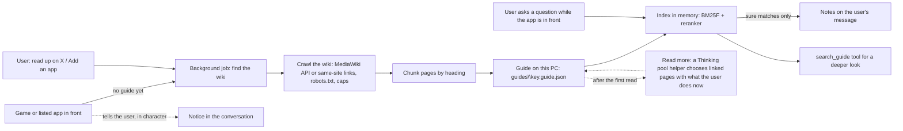

# App guides: game and app knowledge from the web

Design for **app guides**: Martlet reads up on a game or app the user runs (its
fan wiki, its help pages) and keeps what it read on this PC as a searchable
guide. When the user then asks *"hey Martlet, where do I find iron ore?"* or
*"how do I mask a layer in Photoshop?"*, Martlet answers from that guide.

This came from a community request: a gaming assistant that answers "where do
I find...?" and "what is this?", that scrapes game wikis into a local
knowledge base, that notices when you start a game and asks *"I see you
started Elden Ring. Want me to read up on it?"*, that lets you add your own
apps and wiki pages, and that ranks what it finds well (a reranker).

## What the user sees

1. **Companion › App guides** is on by default, and so is *Read up when I
   start a game or app*. With these defaults, when you start a game Martlet
   has no guide for, it sends the game's name to DuckDuckGo to find its wiki
   and reads the wiki on its own (step 2). The wiki sites see the requests and
   this PC's internet address. The page says so. To stop a read, press **Stop
   reading** or tell Martlet no; to stop reading up on its own, turn off *Read
   up when I start a game or app*; the **Read up on games and apps** box turns
   App guides off. A `guides\library.json` saved with App guides off (by an
   earlier Martlet, where they were off by default) stays off; see
   [Default](#default).
2. Start a game. When Martlet sees a game (or an app on the list) in front and
   it has no guide yet, it reads up on it on its own, once a session, while
   *Read up when I start a game or app* is on (on by default). The app is on
   the list at once, and the job *Reading up on Elden Ring* shows in the talk
   window's task list. In a conversation that runs, Martlet tells you in
   character: *"I see you started Elden Ring. I'm reading up on it so I can
   help."* Tell it you'd rather it didn't and it stops; it remembers that and
   doesn't read up on that app on its own again (**Allow again** on the page
   undoes it).
3. Or say *"read up on Stardew Valley"*, or use **Add an app** on the page:
   the app's name, optional program names (as Windows names the program, if
   they differ) and optional wiki addresses. **Add and read up** reads at
   once.
4. While the app is in front (or the user names it), each question the user
   asks is searched in its guide. The best matching sections go with the
   message as reference notes, and the reply uses them. A message that isn't
   about the app gets nothing.
5. Martlet first reads up to 200 pages of the wiki it finds (about 5 minutes
   on a big wiki), the pages about the game first. It never reads pages about
   other games of the same series. It keeps what it read every few minutes,
   so questions get answers from the guide while it is still reading. When
   Martlet is done, it says so in character (*"I've read up on Elden Ring:
   200 pages."*). Then, when a Thinking pool helper can take research, Martlet
   reads more in the background: the helper chooses up to 300 more pages from
   the links of what was read, with what you do now (see
   [Choosing the pages](#choosing-the-pages)).
6. The App guides page lists every app: its pages, size, when it was read, the
   pages it reads from, its program names, the last problem and whether the
   user said no. Each app has **Read up now** (or **Read again**), **Delete**
   and, after a no, **Allow again**. The app being read has **Stop reading**,
   which ends the read and keeps what Martlet read. **Cancel** in the talk
   window's task list also ends it. The page also says what is in front, as
   App guides sees it.

## How it works

### Finding and reading the wiki (no model needed)

The first read needs no Thinking or Deep thinking model, so it never competes
with the conversation for a graphics card. The reader is `WebGuideBuilder` and the
files next to it in `src\Martlet.Conversation\Guides` (`WikiDiscovery`,
`MediaWikiReader`, `SiteCrawler`, `RobotsRules`, `GuideRun`, `HtmlOutline`).

- **Start pages**: the addresses the owner gave. Martlet reads only those
  sites, and looks for others only when none of them can be read.
- **Wiki farms**: with no start pages, Martlet tries the app's name as a
  Fandom or wiki.gg site (`<name>.fandom.com`, `<name>.wiki.gg`: the name run
  together, with hyphens, and without a leading "the"). It asks each site's
  `api.php` for its name and size, and uses a site whose name is about the app
  and that has at least 10 articles, the biggest first.
- **Web search**: then a search for *"<name> wiki"*, and for *"<name> help"*
  and *"<name> guide"* when nothing was read yet. Wiki hosts (Fandom, wiki.gg,
  Fextralife, `/wiki/` addresses) and help sites (`help.`, `support.`, `docs.`
  hosts, `/help` and `/docs` addresses) score higher. Shops, video, social,
  forum and encyclopedia sites (Wikipedia) are left out. A result counts only
  when its title or address names the app (its whole name, or more than half
  of its words).
- **One wiki**: a site that Martlet found and that gave at least 100 pages
  (`WebGuideBuilder.OneSiteIsEnough`) is the guide's wiki. Martlet does not
  look for a second site then, because that is usually another copy of the
  same wiki (a Fandom and a wiki.gg site). A smaller site can have a second
  site with it (at most 2 sites).
- **MediaWiki sites** (Fandom, wiki.gg and most game wikis) are read through
  their `api.php`, found from the farm's address or from the page's `EditURI`
  link, search link or script path. The pages to read first are the main
  page's links and the site's most linked pages (`Mostlinked`), scored by both
  and by size. Stubs, disambiguation pages, version history and very large
  pages are left out. Each page picked from a category lowers the score of the
  others in that category, so the first pages cover the game's different parts
  (fish, cooking, minerals), not one navigation box (every villager). Then come
  the pages that the pages read link to most, and then the other content
  pages of the wiki (`generator=allpages`, 500 titles a request, in title
  order), until the caps. In each batch, titles about the game come first and
  titles about another game of the series are left out
  ([Choosing the pages](#choosing-the-pages)). Each page comes from
  `action=parse` with redirects followed and edit links and the table of
  contents off.
- **Other sites** are read breadth first through links on the same site and
  under the start page's folder (its parent while the folder has fewer than 5
  of the page's links), each page once by its canonical address. Links with a
  query, and edit, talk, user, file, special, media, login, search and shop
  pages, are left out. A wiki whose `robots.txt` forbids its `api.php`
  (minecraft.wiki) is read this way.
- **Text**: each page keeps its headings as Markdown lines, so sections stay
  together when the page is cut into chunks of at most 1,200 characters.
  Paragraphs, list items and table rows are lines of their own. A table cell
  is named by its column heading ("Season: Spring; Price: 75g"), a cell that
  spans rows is repeated on each row, and infobox facts are "Key: Value"
  lines. Navigation boxes, references, edit links, galleries, images,
  struck-through text and hidden parts are left out.
- **Politeness and safety**: each site's `robots.txt` is read once and obeyed
  (RFC 9309): the group that names Martlet, else the group for every agent,
  with the longest rule deciding and `Allow` winning a tie. A
  `Content-Signal` with `ai-input=no` means Martlet reads nothing there. A
  site that refuses its `robots.txt` (4xx) has no rules; a site that can't
  serve it (5xx or no answer) is left alone. A page a redirect took to
  another place is kept only when that place's `robots.txt` allows it.
  Martlet sends one request at a time to a site (a host), waits the longer of
  `GuideBuildLimits.Delay` and the site's `Crawl-delay` between two, and asks
  nothing more of a site that answers 429 or 503. Two web searches also have
  that pause between them, and a refused search ends the searching. Its user
  agent is honest:
  `Martlet/1.0 (app guides; +https://github.com/throndir2/Martlet)` (wiki
  hosts refuse browser-like agents from programs). Every request goes through
  the same safe web client as web research (`WebAccess`: public internet
  addresses only, every redirect checked, size and time caps, at most 2 MB a
  document).
- **Caps**: by default (`GuideBuildLimits`) the first read takes at most 200
  pages, 25 MB and 15 minutes, from at most 2 sites. On a big wiki a page
  takes about 1.4 s and 52 KB, so 200 pages take about 5 minutes and 10 MB
  and keep about 1 MB of text. Reading also ends when the wiki has no more
  pages, when the guide store can hold no more (below), when the owner stops
  it (**Stop reading**, or **Cancel** in the talk window) or when Martlet
  closes. Reading more after it (`GuideBuildLimits.More`) takes at most 300
  pages, 25 MB and 20 minutes from the same wiki. Before these caps (0.70.1 to
  0.74.0) Martlet read the whole wiki: on the Borderlands Wiki (10,700
  articles about every Borderlands game) one read of Borderlands 4 took 72
  minutes and 166 MB for 3,195 pages before it was stopped, and most of them
  were about other games. A guard ends a job
  whose requests give no pages: at most 3 requests a page read, plus 100 to
  find the wiki (and at most 3 a page of the cap, plus 30). Checks pass small
  caps (pages, bytes, time); a pause that would pass the time cap ends the
  job. Cancelling stops it at once.
- **Kept while reading**: every 3 minutes (`AppGuideService.KeepEvery`) the
  read keeps the pages read so far as the app's guide and makes its index
  again. So a long read can be searched as it grows, and a read that ends
  early (cancelled, or Martlet closed) keeps what it read until the last
  keep. **Stop reading** keeps everything read up to that moment.
- **Progress** is a few plain words ("Looking for its wiki", "Reading the
  wiki's page list", "Reading page 3 of at most 200", "Saving what it read so
  far"), never a link.

### Choosing the pages

A wiki can be about a whole series. The Borderlands Wiki has about 10,700
articles about every Borderlands game, and titles such as "Sidewinder
(Borderlands 2)" and "Legendary (Borderlands 4)" tell the games apart. Martlet
chooses pages from their titles before it downloads them
(`GuidePagePicker`, `src\Martlet.Conversation\Guides\GuidePagePicker.cs`).

1. **The first read** uses no model. A title whose brackets name this game,
   or that holds the game's whole name ("Borderlands 4 Weapons"), comes first
   in each batch. A title about another game of the series is left out: its
   brackets or its name have another number ("Sidewinder (Borderlands 2)",
   "Borderlands 2", "Fallout 76" for Fallout 4), or its brackets share the
   name but miss its number ("Power armor (Fallout: New Vegas)" for
   Fallout 4). Other titles ("Moxxi", "Whiterun (Skyrim)") are read in the
   usual order. Roman numerals count as numbers ("Dark Souls III" is "Dark
   Souls 3"). On a wiki whose name isn't the game's ("Borderlands Wiki" for
   Borderlands 4), Martlet reads the game's own pages first: the main page's
   titles that name the game, then the wiki's own search for the game's name
   (`list=search`, 50 titles), then the pages those link to. The main page's
   other pages ("Borderlands (film)") come only after those links. On the
   real Borderlands Wiki, all of the first 25 pages were Borderlands 4 pages.
   The read ends at 200 pages, and the job tells the user that the guide is
   ready.
2. **Reading more** starts after the brief, as research on the Thinking pool
   (`AppGuideResearcher`), only when a pool member can take research. It
   collects the titles that the first read chose but didn't reach and the
   titles its pages link to that Martlet didn't read (`GuideMore`), the most
   linked first. A pool member
   (`GuidePageChooser`) gets 150 titles at a time with the game's name and
   notes on what the user does now: the screen, sound and activity notes on
   the context board and the last 4 exchanges (what the user said or wrote,
   and the replies), at most 3,000 characters. It answers with the numbers of
   the pages worth reading, best first, or NONE. Martlet reads the chosen
   pages, then asks about their links, until 300 pages, 25 MB or 20 minutes.
   It never reads a page that no one chose: a batch the member can't answer
   is left out, and after 3 failed asks in a row (or 80 asks) reading more
   ends. The pages join the guide (the research sections stay last), and the
   brief is written again. The page shows it as *Reading more*, and **Stop
   reading** ends it and keeps what it read.
3. The model work goes only to a Thinking pool member as a Research job (the
   lowest priority), never to the conversation's own route, so it never adds
   latency or pushes the conversation out of a local model's cache. The ask's
   instructions are the same every time. The desktop log has counts only
   (*read more of a wiki in 4 minutes: 1,240 linked titles, 9 of 9 asks
   answered with what you do now, 180 pages added ...*), never titles,
   notes or links.

### Searching a guide (on the reply's path, with no added wait)

[Never add conversation latency](../AGENTS.md#never-add-conversation-latency)
decides the design: the search runs in this process and no model is asked. A
search over 5,000 chunks takes about 0.15-0.2 ms on average
(`AppGuideRetrievalTests` keeps a loose guard on it). The hot methods are
compiled fully optimized from the first call, because a user sends too few
messages for the runtime to optimize them later. The search runs on the shared
[search engine](SEARCH.md) that memory and past conversations also use:
`GuideRanking.Search` is the guide's profile, and `GuideQuery` and
`GuideReranker` give the guide's own query and features.

Build the index with `GuideIndex.Build(guide)`, or with
`GuideIndex.Build(chunks, names)` to give the app's program names too, so the
app's own name in a question is handled (below). An index is read-only and
thread-safe.

1. **Words** (`SearchTerms`, Martlet.Core): runs of letters and digits in
   lower case, accents on Latin letters left out (*Pokémon* finds
   *pokemon*), common grammar words and contractions left out (*don't*,
   *dont*, *I'm*), and a light English stem: plurals, *-ing*, *-ed*, *-ied*,
   *-ly* and common irregular forms (*swords* finds *sword*, *found* finds
   *find*, *wolves* finds *wolf*, *manually* finds *manual*). A guide page in
   Spanish, French, German, Portuguese or Italian also gets that language's
   grammar words left out and its light stems, and Chinese, Japanese and
   Korean text is read as pairs of characters (see
   [Memory › Lexical retrieval](MEMORY.md#lexical-retrieval-and-reranking)).
2. **The question** (`GuideQuery`):
   - Conversational filler is left out: *hey*, *martlet*, *wtf*, *tf*, *um*,
     *please*, *lol* and similar.
   - The app's full name is left out (*in Elden Ring*). A part of the name
     (*in Stardew*) and question scaffolding (*find*, *use*, *best way*,
     *spawn*, *any tips*) are *soft*: they help the order when a chunk has
     them, and never lower relevance when it does not.
   - *Where* adds soft *location*, *find* and *spawn*, so a wiki's
     *Locations* section comes first. *Who* adds *sell*.
   - Two words that the guide writes as one match it (*fire ball* finds
     *Fireball*), and one word that the guide writes as two matches them
     (*greatsword* finds *great sword*). A short list of spellings and
     near-synonyms match each other (*colour* and *color*, *picture* and
     *image*, *buy* and *sell*).
3. **First stage, BM25F** (`GuideIndex` on `SearchIndex`): each chunk has three fields: the
   page title, the section headings (without the title) and the text. BM25F
   adds each field's term frequency, weighted and length-normalized per
   field, and then saturates the sum once. Weights: title 2.5, section 3.5,
   text 1; length normalization (b): 0.3, 0.4 and 0.6; k1 1.2. The best 40
   chunks go to the second stage.
4. **Second stage, the reranker** (`GuideReranker` on `SearchRanker`). For each candidate it
   measures:
   - *coverage*: the IDF-weighted share of the question's words that the
     chunk has. A word that the guide does not have weighs as much as a
     fairly rare word (one in twenty chunks), so a question about something
     else stays unsure;
   - *proximity*: the smallest window of the text that holds all matched
     words (the "minimum cover"); words that a heading names count as close;
   - *phrases*: question words that are also neighbours in the chunk
     (*iron ore*);
   - *headings*: the share of the question that the title or section names;
   - *specificity*: whether a matched word means something. A word in a
     heading, or one that is rare in the guide, counts fully. An everyday
     chat word (*bed*, *morning*, *love*) that only the text has, or in a
     longer heading (*Your first day* for *how was your day*), counts about
     a third.
5. **Relevance**, from 0 to 1: coverage^1.25 × specificity × (0.7 + 0.3 ×
   closeness), where closeness is the best of proximity, phrases and
   headings (1 for a one-word question). `GuideRecall` sends only hits at or
   above 0.5 (at most 3 chunks and 2,400 characters). On the fixture below,
   every question has a right section at or above 0.5 except one, and no
   off-topic chat gets above 0.39.
6. **Diversity**: maximal marginal relevance (weight 0.25, which is λ 0.8) on
   word overlap and page. A chunk with 80% or more of the same words as one already chosen is
   left out, and a page gives at most 2 hits before every other candidate
   has had its turn.

**Chunks** (`GuideChunker`): a new chunk at each heading, so a section stays
together. Lines (paragraphs, list items, table rows) are gathered up to 1,200
characters; a line is cut only when it alone is longer, at a sentence end. A
section too short to be a chunk (*Price*: *7 gold*) joins a neighbour as
*Price: 7 gold* instead of being lost. When a long section continues in the
next chunk, that chunk starts with the last sentence of the chunk before (at
most 160 characters), or with the table's header row when a table
continues.

**The store** (`FileAppGuideStore`): `guides\library.json` and one
`<key>.guide.json` for each app. Each file starts with its `formatVersion`.
The store keeps at most 200 apps, and a guide of at most 25,000 pages and
100,000 chunks of at most 4,000 characters each, in a file of at most 200 MB.
These bounds are what one guide needs to work: a guide is loaded whole and its
index is kept in memory (about 4.5 KB a chunk with its index, so about 440 MB
at 100,000 chunks), and a search over 100,000 chunks takes about 0.7 ms. A
guide of 500 pages (200 read first and 300 read more) makes about 3,000 to
5,000 chunks, far below these bounds; guides read whole before 0.75.0 can be
much larger, and **Read again** makes them small. When a read has more, the guide keeps the pages read first (the
best ones on a MediaWiki site), and the read ends. A file that would pass
200 MB is refused with an `AppGuideTooLargeException` before it replaces the
earlier file; reading up then keeps four fifths of the pages and tries again.
The store refuses a file that it
cannot read, that breaks a bound or that a newer Martlet wrote, with an
`AppGuideFileException` (an `IOException`) that names the file, and it never
resets the library. Saving a whole new library over an unreadable one keeps a
copy (`library.json.unreadable`). Each write goes to a temporary file that is
written through to the disk and then replaces the earlier file. All stores on
one folder in a process share one lock.

**How well it works.** `tests\Martlet.Conversation.Tests\Fixtures\app-guides-held-out.json`
is a synthetic game wiki and an image editor's help site, with pages that
mention everything in passing (main page, patch notes, item lists,
achievements, a glossary). It has 88 questions (half used to choose the
weights, half held out), which include plurals, verb forms, item and place
names, *how do I ... in Photoshop* and filler-heavy voice questions, and 31
off-topic chat lines. Plain BM25 (the first version) against BM25F with the
reranker:

| All 88 questions | Plain BM25 | BM25F + reranker |
| --- | --- | --- |
| Page recall@3 | 1.00 | 1.00 |
| Page MRR | 0.95 | 0.98 |
| Section recall@3 | 1.00 | 1.00 |
| Section MRR | 0.89 | 0.97 |
| Right section sent with the message (relevance ≥ 0.5) | 0.90 | 0.99 |
| Highest relevance of off-topic chat | 1.00 | 0.39 |

On the 44 held-out questions: section MRR 0.91 → 0.97 and answers sent
0.93 → 0.98.

**Choices, from current practice.** BM25F (Robertson, Zaragoza and Taylor,
2004) is the standard way to weight fields such as titles and headings: it
weights term frequency per field before the one saturation, which stops a
term repeated in several fields from counting too much. Proximity scoring
(Büttcher, Clarke and Lushman, 2006; Tao and Zhai, 2007) rewards query terms
that occur close together; the minimum cover window is cheap to find from
the stored positions. Maximal marginal relevance (Carbonell and Goldstein,
1998) is the usual greedy way to trade relevance for variety. The section
headings that every chunk keeps are a form of the "contextual chunk"
technique: context added to each chunk helps lexical search find it. A
cross-encoder reranker or an embedding model would need a model call on
every message, so the guide notes use none (see below).

**Embeddings only in `search_guide`.** A guide is a few thousand chunks, which
an in-memory index searches faster than any database call. Dense embeddings on
the notes would need an embedding model call on every message, which adds a
wait before the first word, and on a gaming PC it can push the conversation's
model out of the graphics card. Game questions are full of proper names
(items, places, bosses), where lexical search is strong. So the guide notes stay
lexical, and only the `search_guide` tool, where a short wait is expected, also
finds sections by meaning: its question's vector is compared with the guide's
section vectors, made in the background on this PC's processor the first time
the guide is searched and kept in `meaning\guides`, and the sections it finds
are fused with the lexical order ([Finding by meaning](SEARCH.md#finding-by-meaning)).
*How do I make my weapons stronger?* then finds the blacksmith's upgrades. The
vectors of a deleted guide are deleted with it.

### What goes to the model, and what stays in the guide

The question this answers is *what goes straight to the model and what stays
in the database*: everything stays in the guide on disk, and only the few
sections that match the current question go with the message, as notes after
the conversation's cached start. Instructions and earlier messages don't
change, so prompt caches still hold. The notes say the text is reference
material read from the web, which may be wrong, and never instructions.

### Tools

While App guides are on and the Thinking route does function calling, every
reply gets three tools after Martlet's other tools, always worded the same, with
the *App guides* prompt (Companion › Prompts), so the start of every request
stays the same:

- `read_up_on(app, sites?)`: starts the reading-up job (the user asked) and
  returns at once; it says so when Martlet already reads up on that app.
- `search_guide(app?, question)`: searches a guide for more than the notes
  carried (the app in front when `app` is left out) and returns the sections
  with their page titles, links and relevance. Sections close in meaning to the
  question join those found by its words
  ([Finding by meaning](SEARCH.md#finding-by-meaning)). It also searches the web
  research reports Martlet wrote, with the same chunker and index; `app` can
  name a report (see
  [Finding a report again](CONVERSATION.md#finding-a-report-again)).
- `skip_guide(app)`: the user doesn't want Martlet to read up on the app; it
  stops reading up on it when it does now, and never reads up on it on its own
  again.

A fourth tool comes with the same three, also always worded the same:

- `update_guide_brief(app?, focus?)`: starts a background job that writes the
  app's brief again (see [The brief](#the-brief)). With a `focus` (for example
  the area the player is in), the job first researches that area (see
  [Researching where you are](#researching-where-you-are)) and then writes the
  brief about it. It returns at once. It refuses when no Thinking pool member
  can take the job.

The prompt tells the model to use `read_up_on`, never `research` or
`think_longer`, to read up on an app, and never to say it read up on something
before a note says its guide is ready. When the reply can't call `read_up_on`
(the route doesn't do function calling, or the model rejected tools), the
user's own words *read up on X* start the job instead
(`AppGuideTools.AskedToReadUp`: *it* or *this game* is the app in front, and
*don't read up on…* is never a request), and the notes tell the model.

### The brief

Reading the wiki uses no model. After each read (and after *Read again*), a
background job asks a Thinking pool member to write a short **brief** about
the app: what it is, its core loop, its main mechanics, early tips and common
mistakes (`GuideBrief`). The job gives the member the guide's best sections for
these topics and the first sections of the guide, at most 9,000 characters.
The brief is at most 2,000 characters of plain lines.

- The brief is kept on the app's entry in `library.json` (`brief`, `briefAt`).
  The old brief stays until a new one is written.
- The brief goes with the first message about the app in a conversation,
  between `[MARTLET_APP_BRIEF]` labels, after the conversation's cached start.
  It is not sent again while the conversation carries it.
- The job is a `Research` job (the lowest priority) on the Thinking pool only.
  It never uses the conversation's own Thinking model, so it never pushes the
  conversation out of a local model's cache. With no pool member that can take
  it, no brief is written.
- At most 6 briefs are written in an hour.

### Researching where you are

Martlet uses what is on the screen to find where the player is (an area, a
level, a quest or a menu) and reads more about that place. It uses the screen
digests that are already on the context board; it adds no new screen capture.

1. When a screen digest changes while a game or app with a guide is in front,
   a pool member names the area (`AREA: <name>` or `AREA: NONE`). This happens
   at most once in 5 minutes.
2. Martlet searches the guide for the area first. When the guide has enough
   on it, nothing is read on the web.
3. Else Martlet searches the web (`<app> <area> wiki`, `... reddit`,
   `... guide`), through the same polite web reader as the wiki read
   (`WebAccess`: honest user agent, `robots.txt`, a pause between requests).
   It reads at most 3 pages. Of Reddit, YouTube and other video sites it keeps
   only the search result's short text, and never reads the page.
4. A pool member writes a short summary from what was found.
5. The summary and the best parts of the pages are added to the guide as
   *Researched:* sections. A guide keeps at most 400 such sections and 40
   areas. *Read again* keeps them.

Limits: at most 4 areas an hour, and the same area again only after 24 hours.
`update_guide_brief` with a `focus` researches an area again after 1 hour. The
log has counts and times only, never area names, questions, links or text.

Research needs App guides on, *Read up when I start a game or app* on, screen
digests on (they give the clues) and a Thinking pool member. It costs nothing
when the pool members are local. On a paid cloud pool member it is bounded by
the limits above.

## On the desktop

- **The library** (`AppGuideService`) keeps `<data folder>\guides\library.json`
  in memory, and a search index only for the guides that can be used now.
  Indexes are built off the reply's path (`Warm`, on a thread-pool thread):
  when an app with a guide comes to the front, when a message or
  `search_guide` names an app, and while a guide is read or made. Each index
  has the app's name and program names, so a question that names the app
  isn't matched on the name. A message never waits for an index; it goes
  without until it is ready. Martlet loads no index when it starts.
- **Memory**: a guide is loaded whole with its index, about 4.4 KB a chunk on
  synthetic chunks and more on real wiki text: about 0.5 to 0.9 GB for a
  full-size guide (100,000 chunks) and about 90 to 180 MB for a wiki of about
  5,000 pages. So `Trim` drops the indexes that can't be used now. With each
  look of the watch (every 4 seconds) it keeps the index of the app in front
  and of the guide being read, and of the others only the 2 used last
  (`MaximumOtherIndexes`), each for 10 minutes after its last use
  (`IndexIdleTime`). When the watch stops (App guides off) it drops them all.
  After it drops a large index, it asks for a background garbage collection,
  so a game gets the memory back soon. While a read keeps its guide, the old
  and the new index are in memory together for a moment.
- **Unreadable files**: a library or guide file the
  store can't read (or a newer Martlet wrote) is never reset: the page says
  which file and why, and a message about that app goes without. A guide the
  store refuses (too large, a full library) becomes the app's problem.
- **Detection** (`AppGuideWatch`) runs only while App guides are on, on a
  thread-pool timer every 4 seconds: it reads the name and file of the program
  in front (`ActiveApp`), whether it fills its screen and whether Windows says a
  game runs in exclusive full screen, and tells a game with
  `PcActivity.Classify` (a game library folder or exclusive full screen). It
  matches the program to the list by key, name or program names, ignoring case
  and punctuation (*ELDEN RING™* is *Elden Ring*). Martlet's own windows are
  passed over.
- **Reading up on its own.** When a game (or an app on the list) without a
  guide comes to the front, *Read up when I start a game or app* is on, nothing
  else is being read up on, the user never said no to it and its last try
  didn't fail, Martlet starts the job itself, once a session
  (`AppGuideService.Offer`). It never waits for the model: Martlet used to ask
  first and read up only when the model called `read_up_on` on a yes, so a
  Thinking route without function calling, or a model that only answered in
  character, said it read up while nothing was read and the game never reached
  the list. The name is the program's, made readable
  (`AppGuideService.Readable`: *AbioticFactor-Win64-Shipping* is *Abiotic
  Factor*, *StardewValley* is *Stardew Valley*), and the names Windows gives
  the program join the entry, so its guide is used while it is in front. In a
  conversation that runs, the job runs there and a notice (`guideoffer`) tells
  the user as soon as Martlet is free, with the *App guides: reading up on a
  game you started* prompts; without one, the main window reads up by itself.
  The setting is kept as `askWhenStarted` in `library.json`, so a no to asking
  stays a no to reading.
- **The job** (`guide`: one at a time, 4 an hour, a 20 minute time limit, *Reading up
  on*) runs the wiki reader, the chunker and the store; no model is asked. The
  app is on the list from the start. Its result tells the reply how many pages
  it read, or why it failed. Reading up from the page runs in the conversation
  when one runs, else on its own. **Cancel** in the talk window or **Stop
  reading** on the page ends it.
- **Notes**: on each of the user's own messages, while App guides are on, the
  guide of the app the words name (else of the app in front) is searched with
  the user's words. Sections the conversation already carries aren't sent
  again, and a message too long to fit drops the guide's sections first after
  earlier conversations. The latency timeline marks *app guide*; the desktop
  log notes counts, relevance and time only.
- **MCP**: `app_guides_check` rehearses all of this against a fixture wiki on
  loopback (including a game in front, named as Windows names an Unreal game's
  program, read up on with no model) and measures the notes step;
  `app_guides_status` reads a data folder's library; the page's status lines
  are `SafeValues` (see [MCP](MCP.md)).

**Latency.** On a guide of 2,000 sections the notes step takes about 0.2 ms
(median) for a message about the app, and nothing while App guides are off.
On a guide of 25,000 sections it takes about 0.6 ms (median;
0.35 ms for an unrelated message), and its index takes about 1.2 s to build,
off the reply's path. The first search in a new process takes about 3 ms,
because building an index also loads the search code. While on, the three
tools and the prompt add about 2.5 KB to every request, the same every time,
so prompt caches keep them.

### Default

App guides are on by default (`AppGuideLibrary.DefaultOn`), and *Read up when
I start a game or app* is on by default too
(`AppGuideLibrary.DefaultReadUpWhenStarted`). So for a new user, Martlet sends
a game's name to DuckDuckGo and reads its wiki on its own when the game
starts, and tells the user in character. The user stops it with **Stop
reading** or a no (which Martlet keeps for that app), or turns off *Read up
when I start a game or app*. The choice is `on` in `guides\library.json`:

- No `library.json` (a new user, or one who never used App guides): on.
- A `library.json` without `on`: on.
- A saved `"on": false` stays off. Martlet 0.69 and 0.70 had App guides off by
  default and always wrote `on`. They wrote `library.json` only after the
  owner did something with App guides: turned the box on or off, added or
  deleted an app, read up or said no to an offer. Martlet can't tell an owner
  who turned App guides off from one who added an app while they were off, so
  both stay off. Either can turn them on with one box.
- A `library.json` Martlet can't read: off, until the owner turns App guides
  on again (as before).

Until the library is read at start, the service reports App guides as off, so
no request gets the guide tools before Martlet knows the owner's choice.

**Latency with App guides on by default.** A reply's path gets nothing that
App guides didn't already add while on: the notes step reads memory only
(well under a millisecond), the watch runs on its own timer, and reading up is
a background job with no model. The three tools and the prompt (about 2.5 KB)
are the same in every request, so prompt caches keep them; only a request that
misses the cache (the first one after a start) reads them again.

## Files

| Part | Where |
| --- | --- |
| Shared types and interfaces | `src\Martlet.Conversation\Guides\GuideContracts.cs` |
| Search words | `src\Martlet.Core\Text\SearchTerms.cs` |
| Search engine (index, ranker, measures) | `src\Martlet.Core\Search\` ([Search engine](SEARCH.md)) |
| Chunker, index and reranker | `src\Martlet.Conversation\Guides\GuideChunker.cs`, `GuideIndex.cs`, `GuideQuery.cs`, `GuideReranker.cs` |
| Store (`guides\library.json`, `<key>.guide.json`) | `src\Martlet.Conversation\Guides\FileAppGuideStore.cs` |
| Wiki reader | `src\Martlet.Conversation\Guides\WebGuideBuilder.cs` |
| Notes on the message | `src\Martlet.Conversation\Guides\GuideRecall.cs` |
| Library service, tools, job kinds and texts | `src\Martlet.Conversation\Guides\AppGuideService.cs`, `AppGuideTools.cs` |
| Detection | `src\Martlet.Desktop\AppGuideWatch.cs` |
| Tools, job, offer and notes in the conversation | `src\Martlet.Desktop\LiveConversationController.Guides.cs`, `LiveConversationWindow.AppGuides.cs` |
| The App guides page | `src\Martlet.Desktop\MainWindow.AppGuides.cs` |
| MCP | `src\Martlet.Mcp.Protocol\AppGuidesCheck.cs` |

## Privacy

- On by default, and so is *Read up when I start a game or app*: when a game
  without a guide starts, Martlet sends its name to DuckDuckGo and reads its
  wiki on its own, and the wiki sites see the requests. The page says so.
- The user stops a read with **Stop reading** or a no (kept for that app),
  stops reading on its own with *Read up when I start a game or app*, and
  turns App guides off with one box.
- Detection reads only the program's name and whether it fills the screen
  (`ActiveApp`, `PcActivity`), never window titles or the screen.
- Reading more gives a Thinking pool member (the owner's own pool, as a
  Research job) the game's name, wiki page titles and notes on what the user
  does now: the screen, sound and activity notes and the last 4 exchanges.
  These notes are used only to choose pages and are never kept in the guide.
  The page says so.
- Guides hold public web pages only, never the conversation. The desktop log
  notes counts (pages, chunks, bytes, time), never questions, links or text.

## Delivery

The contract (this document, the types and simple first versions) landed
first. These workstreams then ran in parallel, one pull request each:

1. **Retrieval and store**: BM25F, the reranker, relevance, the chunker and a
   bounded, atomic store.
2. **Wiki reader**: wiki discovery, `robots.txt`, the MediaWiki API, the
   same-site crawl and heading-preserving text.
3. **Desktop**: detection, the offer, the tools, the job, notes on the
   message, the App guides page and MCP.
4. **Memory recall**: the same search words, BM25 and a reranker for
   remembered facts ([Memory](MEMORY.md)).
5. **Past conversations**: the same for earlier conversations.
