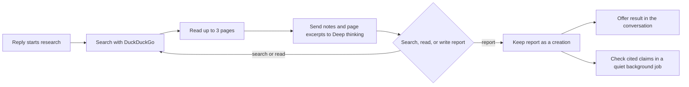

# Deep research: web search and long research jobs

**Status:** Partial
**Last Updated:** 2026-11-13
**Audience:** Developers and coding agents
**Last verified:** 2026-11-13 against 29b352d47
**Code:** `src/Martlet.Conversation/Research`, `src/Martlet.Conversation`, `src/Martlet.Core/Creations`, `src/Martlet.Providers`

Web research runs in the background and searches for and reads pages. A quick
lookup returns an answer. Full and deep research create reports with sources
while the conversation continues. This page separates current behavior from
dated research and planned work. Research provenance is
[S51](RESEARCH.md#s51-web-search-and-deep-research-2026-10-06); sources are
listed [below](#sources).

## What Martlet already has

The research job uses the existing background-job scheduler, Thinking pool,
tool calling and creation system.

| Piece | Where | What research reuses |
| --- | --- | --- |
| Background jobs | `Martlet.Conversation.BackgroundJobs`, [Background job API](CONVERSATION.md#background-job-api-for-new-kinds-of-background-work) | A `research` kind: limits, cancel, time limit, the talk window chip, delivery of results into the conversation |
| Deep thinking | `ThinkLonger`, `BackgroundThink`, `DeepThinkingPlan` | The model that runs the loop, beside the conversation (cloud, a second Ollama model, a paired computer's Thinking pool role) |
| Function calling and MCP | `TextTools`, `McpToolService`, `Martlet.Mcp.Client` | The reply's `research` tool; any search MCP server the owner adds |
| Creations | [Creations](CREATIONS.md) | A `report` kind keeps the finished report on every computer |

### Planned

A SearXNG search host role is not implemented. See
[planned search backends](#planned-search-backends).

## Limits in the current code

- One request carries at most 32 tool rounds
  (`BoundedTextInput.HardMaxToolRounds`), 16 calls a round and 120,000 characters
  a tool result (less when the reply's context has less room; a cut result says so). A research loop runs for dozens of steps, so it can't be one
  long tool conversation. The job drives the loop itself: each step is a fresh,
  bounded request that carries compressed notes, not the whole history.
- A paired computer's Deep thinking route (`deep-thinking-chat`) takes no tools
  (`ThinkLonger.HostBounds`). Research steps use **structured text fields**
  instead of native function calls. This lets the loop run on a Deep thinking
  model without tool support.
- Full and deep jobs have no time limit. A quick lookup has a 10-minute limit.
  Their search, page, step and byte budgets bound the work, and Cancel stops it.
- [Never add conversation latency](../AGENTS.md#never-add-conversation-latency):
  the reply only gains one tool definition that is always offered in the same
  place while research is on, so the request start and prompt cache stay the
  same. The loop runs on Deep thinking, never on Thinking's model on this PC or
  a computer that is answering. Search and fetch use asynchronous network calls
  in the background job.

## How a research job runs

The job can wait until the conversation pauses and a Deep thinking place is
free. It reads up to three pages after the first search and up to three pages
per later step. Each step sends the model its notes and new page excerpts.
The model returns notes, an optional finding, and then a search query, up to
three page links, or a report. A quick lookup returns when the watcher finds an
answer. Full and deep research can send an early finding while the report
continues. The final report is kept as a creation.

### Budgets

| Depth | Model steps | Searches | Pages | Download limit | Time limit |
| --- | --- | --- | --- | --- |
| Quick | 4 | 3 | 9 | 8,000,000 bytes | 10 minutes |
| Full (default) | 40 | 30 | 60 | 25,000,000 bytes | None |
| Deep | 80 | 60 | 120 | 50,000,000 bytes | None |

Quick lookups allow two jobs at once. Full and deep research allow one. These
limits have no hourly cap. Each request can read up to three new pages. Notes
are limited to 15,000 characters.

### Superseded design notes

The following estimates and plans predate the current implementation. They do
not describe the current limits above.

These match what open-source research agents use (breadth 3-10 queries a round,
depth 2-5 rounds). One job at a time, a few an hour, like `think`. A later step
may run 2-4 sub-researchers in parallel, one per sub-question, each with its own
notes, when Deep thinking answers several requests at once (a cloud provider).
Anthropic reports this works far better but costs about 15 times the tokens of a
chat, so it stays opt-in.

The first slice uses one budget, about what a careful person reads to research
something thoroughly (`WebResearch.Budget`): up to 30 searches, 60 pages and 40
model steps, one job at a time, with no time limit and no hourly limit. Each step
carries the model's own notes (at most 5,000 characters) instead of every page,
so the job fits one message however long it runs.

## Levels, the watcher and the source check

[Answer, look up or research](CONVERSATION.md#answer-look-up-or-research) has the
details. In short:

- **Levels.** The reply's *Web research* prompt is a ladder: answer from what
  Martlet knows, then `search_guide`, then a quick look-up (`depth` *quick*: 3
  searches, 9 pages, 4 steps, a `lookup` job that goes before long work), then
  full research (the budget above), then deep research (about twice that), only
  when the user asks for an in-depth report.
- **The watcher** (`ResearchWatcher`). Each step says `FOUND` once the pages
  answer what the user wants. The watcher takes the first answer that cites a
  page read: a quick look-up ends there, and full or deep research tells the
  user at once with a `finding` notice and goes on for the report. It adds no
  model request.
- **Page parts.** A long page shows its start and the parts that match what the
  user wants, not only its start, so an answer deep in a wiki page is found.
  Pages asked for together are read at once.
- **The source check** (`SourceCheck`). After the report's result is ready, a
  quiet `sourcecheck` job checks cited claims against matching page parts. It
  checks up to 24 claims, six per request, and can add a *Source check* section
  to the kept report. The report does not wait for this job.

### Where the work runs

Every model request of these parts (research steps, the quick look-up and the
source check) is a Thinking pool request of the `research` kind. So it runs on
any pool member that does research (Runs on): this PC, a cloud provider or a
paired computer's Thinking pool role. Only searching and reading pages run in
the desktop process, through the address guard. The watcher and the levels are
rules in code and need no model. A SearXNG search host role is not available
yet; see [planned search backends](#planned-search-backends).

### Research model size estimates (not measured)

An open model trained only for this work can be a Thinking pool member.
Tongyi-DeepResearch-30B-A3B (Alibaba, open weights, trained with reinforcement
learning for long web research) has 30.5 billion parameters, but only about 3.3
billion are active for each token (a mixture of experts). The Hugging Face GGUF
files (bartowski) are about 17.6 GB at Q4_0, 16.5 GB at IQ4_XS and 14.1 GB at
Q3_K_M, read 2026-10-15. So:

- A host with a 24 GB graphics card holds it at Q4 with room for context.
- A 16 GB card holds Q3, or Q4 with some experts in system memory; because few
  parameters are active, it stays usable.
- A computer with no suitable card can run it on the processor with 32 GB of
  memory or more, slowly.
- OpenRouter listed it as a cloud choice when this was researched on 2026-10-15.

It is not needed: the levels work with any Thinking pool model. Its own
search-and-read format is not used; it answers Martlet's text steps like any
model. Nothing was measured on a real host.

## Current search backend

The current code uses DuckDuckGo's unofficial HTML search page through
`WebAccess`. It needs no key or account, but DuckDuckGo can limit or refuse
automated searches. The `IWebSearch` interface is the seam for search providers.

## Planned search backends

The options below are research candidates, not current integrations or
available settings. The current feature uses only the built-in DuckDuckGo
search.

| Backend | Cost | Why | Research choice |
| --- | --- | --- | --- |
| **SearXNG on your own host** | Free, self-hosted | Meta-search over many engines, JSON API, no key. Queries still go to the selected engines. The proposed `search` role would run on a Docker or Linux host. | **Proposed default** |
| **Ollama web search** (`ollama.com/api/web_search`, `web_fetch`) | Free tier with an Ollama account key | No infrastructure; `web_fetch` returns clean Markdown | Candidate |
| **Tavily** | 1,000 credits a month free | Built for LLM use; can return extracted page content | Candidate |
| **Brave Search API** | $5 monthly credit (about 1,000 queries), card required | Its own independent index | Candidate |
| **Exa** | $10 monthly credit | Semantic search with full page contents | Candidate |
| **An MCP search server** | Depends on the server | Any search tool the owner added on the Tools page | Candidate |

Not used: Bing Search API (retired August 2025), Google Custom Search JSON API
(closed to new customers, shuts down 1 January 2027) and Whoogle (breaks as
Google blocks it).

### Planned provider-native research (paid, opt-in)

Some cloud providers already search and research by themselves. Martlet can hand
a job to one instead of running its own loop:

- **OpenAI Deep Research API** (`o4-mini-deep-research`, `o3-deep-research` on
  Responses with `background: true`): runs the whole job in the cloud and returns
  a cited report. The job polls it and delivers it the same way. This costs
  real money per job (dollars for o3), so it needs its own consent.
- **OpenAI Responses `web_search`**, **OpenRouter `openrouter:web_search`** (its
  older `:online` suffix is deprecated) and **Gemini Search grounding**: search
  billed per call while the model works. These can serve as a search backend for
  a cloud Deep thinking model.

These are never the default and never chosen silently: the card shows that they
cost money, like other paid provider choices.

## Current page-reading limits and safety

Every page fetch uses `WebAccess` in the desktop process:

- **Address checks**: the fetcher accepts HTTP and HTTPS links without user
  information. It resolves each connection and connects only to public
  addresses. The connection handler also checks redirected connections. The
  handler follows at most four redirects, disables proxies and stores no
  cookies.
- **Bounds**: a page can download up to 4,000,000 bytes and keep up to 200,000
  characters. Each request has a 15-second timeout. The reader accepts HTML,
  XHTML and plain text; it does not read PDF pages.
- **Extraction**: the reader removes HTML tags and common hidden or navigation
  sections, then collapses whitespace. It does not run page scripts or check
  `robots.txt`.
- **Prompt injection** (OWASP LLM01): page text is data. Each step's prompt marks
  it as untrusted quoted material, and research steps have no tools that act on
  anything: they can only ask for more searches and reads. The finished report
  goes into the conversation as a note like any job result, and the reply's
  normal tool confirmations still apply to anything it does afterwards.

## Privacy and consent

- Web research is **on by default**, so asking Martlet to look something up
  is allowed. A reply gets the research tool only when Thinking longer and Web
  research are on. Its model must support function calls, and a Deep thinking
  place must be available. The card says what leaves the PC, and the owner can
  turn the feature off there. Search queries go to DuckDuckGo. Fetched sites
  receive requests from this PC.
- The desktop log records the job ID, depth, time limit and budget at start.
  When the job gets a model, the log records its model and host. It records
  saved report size and source count, not report text.

### Planned

Paid search backends and provider-native research need separate consent and
clear price information before they can be used.

## Observability (MCP)

The `research_check` tool runs a research job with local fixtures. It does not
contact real sites or real AI models. Safe values show the Web research switch,
and its disclosure.

### Planned

Doctor probes for additional search backends are not implemented.

## Delivery order

1. **R0: first slice** (done): `research` job kind and the
   `research(topic, what_to_find)` tool, the loop on Deep thinking with notes
   carried from step to step, the safe fetcher, a built-in search, the `report`
   creation kind, the WebResearch switch (on by default) and `research_check`.
2. **R0.5: levels, watcher and source check** (done): the `depth` parameter
   and the answer, look up or research prompt, quick look-ups (`lookup`), the
   watcher and its early `finding` notice, matching page parts, pages read at
   once, and the quiet source check that revises the kept report.
### Planned

3. **R1: backends**: `IWebSearch` providers for SearXNG (URL or host role),
   Ollama web search, Tavily, Brave and Exa; fan-out with rank fusion; Doctor
   probes.
4. **R2: SearXNG host role**: `search` role on Docker and Linux hosts
   (`searxng/searxng` and Redis, JSON on, limiter off, paired-only route), added
   like other host roles.
5. **R3: parallel sub-researchers** when Deep thinking answers several requests
   at once, with the depth presets above. Their steps feed the same watcher.
6. **R4: cloud research hand-off**: OpenAI Deep Research in background mode,
   opt-in and paid.
7. **R5: research without a conversation**: start a job from the Creations page
   or a Research box and follow it in Background tasks.

## Sources

Accessed 2026-10-06.

- Search APIs: [Brave plans](https://api-dashboard.search.brave.com/app/plans),
  [Tavily pricing](https://help.tavily.com/articles/8816424538-pricing),
  [Exa pricing](https://exa.ai/pricing), [Jina Reader](https://jina.ai/reader/),
  [Kagi API](https://help.kagi.com/kagi/api/api-portal.html),
  [Google Custom Search JSON API](https://developers.google.com/custom-search/v1/overview),
  [Bing Search API retirement](https://learn.microsoft.com/en-us/lifecycle/announcements/bing-search-api-retirement),
  [Ollama web search](https://ollama.com/blog/web-search),
  [Perplexity Agent API](https://docs.perplexity.ai/docs/agent-api/migrate-from-sonar/overview).
- Self-hosted: [SearXNG search API](https://docs.searxng.org/dev/search_api.html).
- Provider-native: [OpenAI Responses tools and deep research](https://openai.com/index/new-tools-and-features-in-the-responses-api/),
  [Azure OpenAI deep research](https://learn.microsoft.com/en-us/azure/foundry/openai/how-to/deep-research),
  [OpenRouter web search](https://openrouter.ai/docs/guides/features/plugins/web-search),
  [Gemini pricing](https://ai.google.dev/gemini-api/docs/pricing),
  [Anthropic pricing](https://platform.claude.com/docs/en/docs/about-claude/pricing.md).
- Agent designs: [open_deep_research](https://github.com/langchain-ai/open_deep_research),
  [local-deep-researcher](https://github.com/langchain-ai/local-deep-researcher),
  [GPT-Researcher architecture](https://deepwiki.com/assafelovic/gpt-researcher/3-core-architecture),
  [STORM](https://github.com/stanford-oval/storm/blob/main/README.md),
  [dzhng/deep-research](https://deepwiki.com/dzhng/deep-research/2-core-architecture),
  [node-DeepResearch](https://deepwiki.com/jina-ai/node-DeepResearch/3-core-architecture),
  [smolagents open Deep Research](https://huggingface.co/blog/open-deep-research),
  [Anthropic multi-agent research system](https://www.anthropic.com/engineering/multi-agent-research-system),
  [Microsoft Agent Framework](https://github.com/microsoft/agent-framework).
- Research models (accessed 2026-10-15): [Tongyi DeepResearch](https://github.com/Alibaba-NLP/DeepResearch),
  [its GGUF files](https://huggingface.co/bartowski/Alibaba-NLP_Tongyi-DeepResearch-30B-A3B-GGUF),
  [Gemini Deep Research overview](https://gemini.google/overview/deep-research/).
- Extraction and safety: [SmartReader](https://github.com/strumenta/SmartReader),
  [PdfPig](https://uglytoad.github.io/PdfPig/),
  [OWASP LLM prompt injection prevention](https://cheatsheetseries.owasp.org/cheatsheets/LLM_Prompt_Injection_Prevention_Cheat_Sheet.html).
