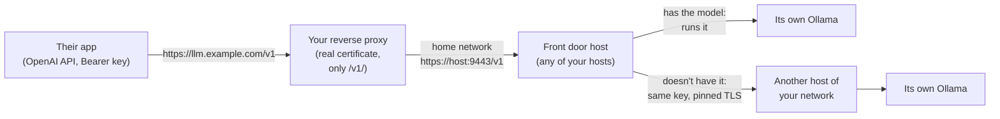

# Share your language models: the OpenAI-compatible endpoint

Every Martlet host serves an **OpenAI-compatible endpoint**: an API in the
same form as OpenAI's, at `/v1`. People you give a key to can use the
language models your hosts run from any app that works with the OpenAI API
(Open WebUI, SillyTavern, Continue, LibreChat, the `openai` Python and
JavaScript libraries, curl and many more). You control it on the **Share**
page.

Words on this page follow the [glossary](GLOSSARY.md#sharing).

## Short answers

| Question | Answer |
| --- | --- |
| What do people get? | The models your hosts run with Ollama (the Thinking and Thinking pool roles), for example `qwen3:8b`. `GET /v1/models` lists them. |
| What do they never get? | The cloud providers and API keys you set in Martlet, and everything else of Martlet: settings, memories, voices, characters, logs, your network and your other engines. A key with only the `openai` scope can't call any other route. |
| How do they get in? | With a key you make on **Share › Share your language models › Give someone access**. Martlet shows a text to send them: the address, the key, the models and a first request. |
| Do my own conversations slow down? | No. Their requests come after yours (below), and they use the context size your own requests use, so a host never loads its model again for them. |
| Which computer answers? | Any host can be the **front door**. It runs a request when it has the model and a free slot. Otherwise it sends the request on, with the same key, to the host of your network that has the model. |
| Do I need something on the internet? | Yes, one address with a real certificate: a reverse proxy (for example Nginx on your Linux server) in front of one host. Martlet gives you the configuration to paste. |

## How it works



1. The app sends `Authorization: Bearer martlet_...` to your public address.
2. The proxy sends only `/v1/` to the front door host on your home network.
3. The front door checks the key itself (keys reach every host by the normal
   [API key sync](API.md#how-keys-reach-your-hosts)).
4. `GET /v1/models` lists the front door's models and the models of every
   other host of your [Martlet network](NETWORK.md), asked with the same key.
   Each entry says which hosts run it (`martlet_hosts`).
5. A request for a model the front door runs goes to its own Ollama when a
   slot is free for the key's rank.
6. Otherwise the front door sends the request to a host that has the model,
   with the same key and the `X-Martlet-Forwarded` header, over TLS pinned to
   that host's key from the roster. That host checks the key again and never
   sends the request on. A host that is busy for its owner gets skipped, and
   the next host that has the model gets the request.
7. The answer comes back as the app expects it: one JSON document, or
   server-sent events (`data: {...}` and `data: [DONE]`) when it streams. The
   `X-Martlet-Host` header names the host that answered.

### What a key may call

| Method and path | What it does |
| --- | --- |
| `GET /v1/models` | The models of your network (an API key) or of this host (a paired computer or a friend's computer, signed). |
| `GET /v1/models/{id}` | One model, or 404 `model_not_found`. |
| `POST /v1/chat/completions` | Chat, with streaming, tools (function calls), JSON mode and JSON schema, pictures as `data:` URLs, recordings as `input_audio`, `reasoning_effort`, `max_tokens`, `temperature`, `top_p`, `stop`, `seed`, `frequency_penalty`, `presence_penalty` and `stream_options.include_usage`. |
| `POST /v1/completions` | Text completion of one prompt (with `suffix`). |
| `POST /v1/embeddings` | Embeddings of a string or up to 512 strings, as numbers or `base64`. |

The key needs the `openai` scope. A key without it gets 403
`permission_error`. Errors use OpenAI's form,
`{"error":{"message","type","param","code"}}`, so the apps show them as they
show OpenAI's own errors. A busy model answers 429 with `Retry-After: 5`, and
the OpenAI libraries try again by themselves.

Limits: one JSON object of at most 32 MB, each top-level name once (so the
model Martlet checks is the model Ollama runs), `n` of 1, and a request runs at
most 15 minutes. The host never fetches a web address for a request: send
pictures as `data:image/...;base64,...`.

### Your requests first

Each key has a priority. Choose it when you make the key, and change it at any
time on the key's row. The change reaches every host within a minute and the
key itself stays the same.

| Priority | What happens |
| --- | --- |
| **Your Martlet first** (the default) | Their requests rank below all of your work, like a friend's. Any of your requests that needs the same graphics card or slot stops theirs at once (their app gets 503 `owner_needs_it`, or an error event in a stream). While your work uses the card, a new request of theirs gets 429 `model_busy`. |
| **Same priority as your background work** (scope `equal-priority`) | Their requests rank with your Thinking pool's work: they run beside it and wait only for free slots. Your live conversations still stop them. |

Their requests never stop your work or anybody else's. The owner of each host
decides with the same [GPU priority](CLUSTER.md#live-turn-first-on-a-shared-graphics-card)
that already puts live turns first.

### Nothing slows down your own conversations

- Martlet translates each request to Ollama's own API. It sends the context
  size of your own last request on that host (or, before one, the size Ollama
  has loaded), and keeps the model loaded (`keep_alive` `-1`). A different
  context size would make Ollama load the model again, and your next reply
  would wait for that. (Ollama's own OpenAI API can't take a context size.)
- Requests share the slots of your host's roles and take part in GPU priority,
  so they never take a slot your reply needs.
- Nothing about the endpoint runs on a reply's path. The Share page reads the
  models only while it shows.

### Keys

Keys for the endpoint are normal [API keys](API.md) with the `openai` scope:
the same format, list, sync, revocation and expiry. **Share › Share your
language models** lists only these keys, with their priority. **Share › Apps
and API keys** lists every key. Revoking a key stops its running requests on
every host that heard about it.

## Give your models an address on the internet

Apps that use the OpenAI API check the server's certificate against the public
certificate authorities. Your hosts use their own certificate, which Martlet
pins, so the apps can't reach a host directly. Put one reverse proxy with a
real certificate in front of one host. Your Linux server (Nahida) with Nginx is
a good place: it is always on and probably already has a proxy.

Martlet makes the configuration for you: **Share › Share your language
models › Show proxy setup**. It fills in your address and the front door's
home address.

1. Choose a name, for example `llm.throndir.com`. In your DNS, add an `A`
   record that points it at your home's internet address (or a `CNAME` to the
   name your other services use).
2. Make your router send TCP port 443 to the proxy computer. If it already
   does for your other sites, nothing changes.
3. Get a certificate for the name. Use `certbot --nginx -d llm.throndir.com`,
   or let Nginx Proxy Manager or Caddy get it.
4. Add the Nginx configuration (below, or from Show proxy setup) to the
   proxy, test it with `nginx -t` and reload it.
5. In Martlet, type the address in **Address to give people**, choose the
   front door host and choose **Save**. Your other computers get the same
   address.
6. Give someone access. Send them the text Martlet shows.

```nginx
# Martlet OpenAI-compatible endpoint: https://llm.throndir.com/v1 -> https://192.168.1.20:9443
limit_req_zone $binary_remote_addr zone=martlet_openai:10m rate=10r/s;

server {
    listen 443 ssl;
    http2 on;
    server_name llm.throndir.com;

    ssl_certificate     /etc/letsencrypt/live/llm.throndir.com/fullchain.pem;
    ssl_certificate_key /etc/letsencrypt/live/llm.throndir.com/privkey.pem;

    client_max_body_size 32m;

    location /v1/ {
        limit_req zone=martlet_openai burst=40 nodelay;
        proxy_pass https://192.168.1.20:9443;
        proxy_ssl_verify off;
        proxy_ssl_server_name off;
        proxy_http_version 1.1;
        proxy_set_header Connection "";
        proxy_buffering off;
        proxy_request_buffering off;
        proxy_read_timeout 900s;
        proxy_send_timeout 900s;
    }

    location / {
        return 404;
    }
}
```

Notes:

- `proxy_ssl_verify off` is safe only because the proxy and the host are on
  your home network. The host's certificate is self-signed and Nginx can't pin
  a key. Never point `proxy_pass` at a host across the internet.
- `proxy_buffering off` lets streamed answers arrive token by token.
- The proxy sends only `/v1/`. Pairing, sign-in and everything else of Martlet
  stay at home.
- `limit_req` limits how fast one internet address can ask. Every request
  still needs a key, and a key is 256 random bits, so it can't be guessed.
- **Nginx Proxy Manager:** add a proxy host for the name with scheme `https`,
  the front door's home address and port `9443`, a Let's Encrypt certificate,
  and a custom location `/v1/` with `proxy_buffering off;`.
- **Caddy:** Show proxy setup also gives a Caddyfile. Caddy gets the
  certificate by itself.
- **Cloudflare Tunnel** (no router port): run `cloudflared` on the proxy
  computer with an ingress rule for the name to
  `https://<front door>:9443` and `originRequest.noTLSVerify: true`. Martlet
  doesn't support tunnels for its own computers (they pin the host key), but
  the OpenAI-compatible endpoint only needs keys, so a tunnel works for it.
- At home, an app that can skip certificate checks can also use a host
  directly: `https://<host>:9443/v1` (Share lists each host's address).

### Which host should be the front door?

Any host works, because each one sends a request it can't run to the host that
can. Choose a host that is always on. When the proxy runs on a computer that
is also a Martlet host, use that host. The choice only changes the address in
the configuration Martlet gives you.

## For people who use your models

The text Martlet makes for them has everything:

```text
Base URL: https://llm.throndir.com/v1
API key:  martlet_...
Models:   qwen3:8b, gemma4:e4b
```

```python
from openai import OpenAI
client = OpenAI(base_url="https://llm.throndir.com/v1", api_key="martlet_...")
reply = client.chat.completions.create(model="qwen3:8b", messages=[{"role": "user", "content": "Hello!"}])
print(reply.choices[0].message.content)
```

The owner's own work comes first. A request can stop with `owner_needs_it`
(503) or wait with `model_busy` (429); the OpenAI libraries try again.

## Friends and the Share page

The **Share** page has everything about sharing, on one page:

| Card | What it does |
| --- | --- |
| Your Martlet network | Your own computers: who is in it, who asks to join (Allow, Turn down), outside addresses. |
| Friends | Your hosts shared with a friend's Martlet by a share link or a sign-in, per person. |
| Share your language models | The OpenAI-compatible endpoint: the address, the front door, the models, the keys and their priority. |
| Apps and API keys | Every API key (Home Assistant, scripts, the endpoint's keys). |
| Hosts shared with this PC | Hosts a friend shares with this PC, with the engines and **language models** each one offers. |

A friend's Martlet sees the language models of each host shared with it on
its own Share page. It uses them through Martlet's own routes (Use for
thinking). A person who wants them in another app asks the owner for a key.

## Where it lives

| Piece | Location |
| --- | --- |
| Scopes, key priority, address and proxy text | `Martlet.Core.Access` (`ApiKeyScopes.OpenAi`, `ApiKeyScopes.EqualPriority`, `ApiKeyList.ChangeScopes`, `OpenAiEndpoint`, `OpenAiEndpointSettings` in `openai-endpoint.json`, shared as `openai-endpoint`) |
| Endpoint, front door and forwarding | `Martlet.Gateway` `GatewayOpenAi.cs` (`/v1` routes, peers from the network roster, pinned forwarding, OpenAI errors) |
| Rank and slots | `GatewayInferenceOutside.cs` (`GatewayInferenceRouteRegistry.BeginOutside`, `GatewayOutsideJob`), with `GatewayInferencePriority.cs` |
| Translation to Ollama | `Martlet.Gateway.Ollama` `OllamaOpenAi.cs` and `OllamaRelayWorker.OpenAi.cs` (`OpenAiContextAsync`) |
| Key checks | `GatewayApiKeys.cs` (`AuthenticateOpenAi`, `EqualPriority`) |
| Desktop client | `Remote/HostOpenAiModels.cs` (`ReadOpenAiModelsAsync`) |
| Desktop UI | `MainWindow.OpenAiEndpoint.cs` (the Share page and its card), `OpenAiDialogs.cs`; the Share page in `MainWindow.xaml` (`SharePage`, `NavShare`) |
| MCP | `openai_endpoint_status`, `openai_selftest` (`Martlet.NodeLinkCheck openai`); IDs in [MCP](MCP.md) |

## Qualification

Checked on the Windows development PC:

- `OpenAiEndpointTests` in `Martlet.Gateway.Tests` (real gateways on
  127.0.0.1 with fixture Ollama servers, NOT AI): models and refusals, a chat
  with the owner's context size and the model kept loaded, streams,
  completions and embeddings, duplicate `model` names refused, the owner's
  reply stopping a shared request, the rank of `equal-priority`, the front
  door sending a model on to another host, and the translation of tools.
- `OpenAiEndpointTests` in `Martlet.Core.Tests`: key priority changes, the
  address and two simulated computers sharing the settings.
- MCP `openai_selftest`: two real gateways joined by real network sync, keys
  synced by the desktop's client, the front door, refusals, owner first and
  revocation.
- MCP with the desktop on a disposable data folder: the Share page, the
  card, Give someone access, the address, Show proxy setup, and a friend's
  view of a shared host's models (`signin_lab`).

**NOT RUN:** a real model, a real reverse proxy with a public certificate,
a real OpenAI client library, Docker or native Linux hosts, and two physical
PCs on a real network.
