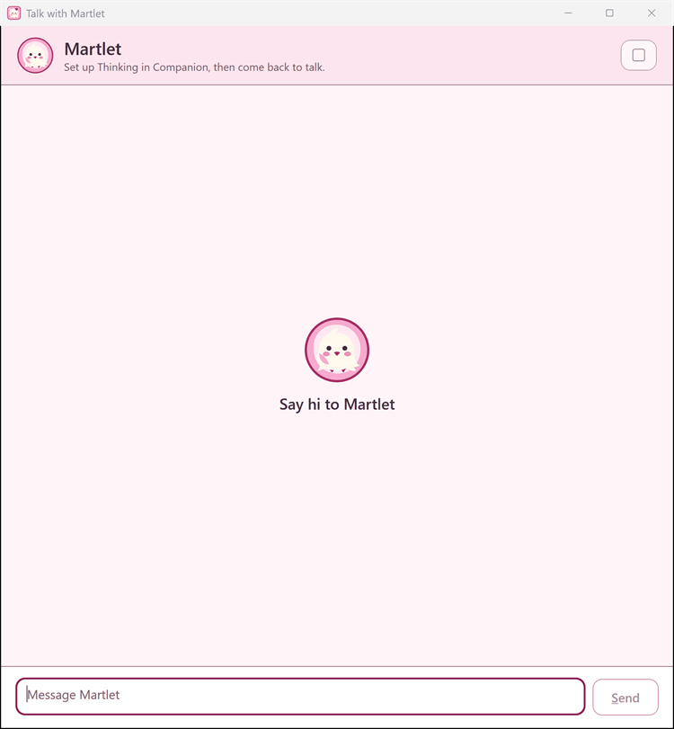

# Talking to Martlet

**Status:** Implemented
**Last Updated:** 2026-11-13
**Audience:** Users
**Last verified:** 2026-11-13 against b1688a8de
**Code:** `src/Martlet.Desktop/LiveConversationWindow.xaml.cs`, `src/Martlet.Desktop/LiveConversationController.TurnCapture.cs`, `src/Martlet.Desktop/TalkPreferences.cs`

Talk hands-free, hold a key or type. Martlet can answer out loud. You can change how she waits and how you interrupt her.

## Ways to talk

| Way | How |
| --- | --- |
| **Always listening** (the default) | Press **Start listening** on Home or in the talk window. Martlet answers when you pause and listens again after each reply, until you press **Stop listening**. |
| **Push-to-talk** | Choose it in **Companion › Listening › How you talk**. Hold **Hold to talk** (or Space) in the talk window, speak, then release to send. |
| Type | Press **Start talking** on Home. Type in the talk window and press Enter. Shift+Enter starts a new line. |
| Discord | Set up the bot in **Companion › Discord**. See [Discord](Discord). |
| Telegram and WhatsApp | Pair a chat in **Companion › Messaging**. See [Telegram and WhatsApp](Telegram). |

Nothing listens until you press a button. Starting Martlet does not open the
microphone, and no letter key starts listening or watching.

With always listening, Martlet listens again after each reply, with or without
the talk window open. **Stop listening** ends it, and locking Windows pauses it
until you unlock Windows. When you close the talk window, Martlet keeps
listening and watching. Stop them on Home or from the notification-area icon.
**Pause Martlet** on that icon stops listening and looking until you resume Martlet
there.

A PC that you set up as a Martlet host doesn't talk, listen, watch or show the
character. To change that, choose **Use as my companion PC** in **Settings**.
Your companion choices come back when it is your companion PC again.

One turn of talking can last up to 10 minutes. Martlet transcribes long speech in
pieces, using pauses where possible. A failed transcription can still lose words.

## The talk window

- **Start talking** on Home opens the talk window. While it is open, the button
  says **Show conversation**. The window has its own taskbar button, so it can
  stay open beside your work.
- It calls your character by its personality's name, and labels each message
  with the name of the person who spoke.
- The small icons at the top start and stop listening and watching. Hover over
  an icon to see what it does.
- **Stop** (or Esc) stops the reply, drops what waits to be answered and stops
  watching. Listening stays on.
- **What was sent** under each of Martlet's messages shows everything that
  went to the Thinking model for that reply.
- **Refresh context** makes the next reply start fresh. The messages stay on
  screen.
- **Warming up** shows while Martlet loads its model. You can talk or type at
  once. The first reply starts when the model is ready.
- **Hold to talk** (push-to-talk): hold the button or Space, then release to
  send. Esc throws the recording away. In the message box, Enter sends and
  Shift+Enter starts a new line.
- **Background tasks** shows how many tasks Martlet works on while you talk.
  **Stop** (Esc) doesn't end them. **Cancel** stops one task, and Martlet
  hears that you stopped it the next time you talk. A reminder that is due
  comes up as soon as Martlet is free.
- **Stop singing** lets Martlet finish the word, and the band rings out on the
  beat. Martlet hears where the song stopped, so you can ask her to pick it up
  again.
- While Martlet watches, she looks at your screen or camera now and then and
  sends the newest picture with what you type or say. With an image model,
  that model describes the pictures in words for the Thinking model. Hover over
  the watching icon to see where pictures go and when Martlet last looked.
- **What was sent** is shown on this PC only. Martlet keeps it for the newest
  messages while the conversation is open, and never saves or logs it. A
  recording in it plays on Windows' default speakers.

### The Conversations page

The **Conversations** page shows saved exchanges from the talk window and supported messaging channels.
Martlet keeps them while Memory and conversation history are on.
Change this in **Companion › Memory › Conversation history**. Screen looks and PC audio are not saved there.

- With **Keep Martlet the same on all my computers** on, the record is the same
  on every computer where you are signed in.
- Edit or delete a message, a conversation or everything at any time. The
  change goes to all your computers. Deleting can't be undone, and Martlet
  can't bring the deleted messages up again.
- Facts that Martlet remembered from a deleted conversation stay in
  [Memory](Memory). Delete them there.
- When you delete a recorded message, you can also request deletion in Telegram or Discord.
  This needs the messaging app to allow it. An empty edit becomes a deletion.
- **Stop waiting** cancels changes that still wait to be made in Telegram and
  Discord. Those messages then stay there as they are, and the record here
  doesn't change.

### Messages in the talk window

When a reply fails, the talk window shows the problem and a suggested action.
Check the selected provider, model, voice or microphone first.
For more help, see [Troubleshooting](Troubleshooting).

## How Martlet takes turns

These settings are in **Companion › Listening › How you talk**.
Open **More listening settings** for the judge, early replies, word check and interrupting choices.

- **She hears when you have finished.** With **Judge when I finish talking**
  on (the default), a small model on this PC (Smart Turn) listens to how you
  end each sentence after a short pause. Martlet answers sooner when you are
  clearly done. She waits longer when you trail off. The limit is at least 1.6 seconds
  or twice **Reply after**, whichever is longer, up to 5 seconds. If she answers too soon, just keep talking. Your voice
  never leaves this PC for this. When the judge can't run, the pause alone
  decides until it can. Off, the pause alone decides.
- **She starts in the pause.** With **Start replies early** on (the default),
  Martlet starts on her reply in the short pause after you speak. She shows and
  says nothing until your turn ends. If you keep talking, she drops that start.
  This needs Parakeet on this PC for listening and a Thinking model on your
  own computers. **Also for cloud models** allows it with a cloud model, which
  can add a small cost, because a dropped start still uses the model.
  **Prepare the voice early too** also makes the first spoken words ready
  before you finish (a paid cloud voice only with **Also for cloud models**).
  The status line under it counts how many early starts became the reply.
- **Reply after** sets how long a pause ends your turn. **Sensitivity** sets
  how readily Martlet hears quiet speech.
- **Word check** (Relaxed, Normal or Sensitive) sets how readily a sound
  counts as words. Martlet ignores sounds that aren't words (mm, hmm, uh, a
  cough, laughter) and the words that speech-to-text often makes up from noise,
  such as "Thank you.", when the evidence that you said them is weak. **Relaxed** ignores more: Martlet needs clearer, longer
  speech to answer you or to stop. **Sensitive** also takes single short words.
  A short answer such as "yes", "no" or "stop" works with all three, mainly
  right after Martlet asks something, and anything with Martlet's name counts.
  The talk window shows a faded *Ignored* note for what she ignored.

## How Martlet answers

- She speaks each reply sentence by sentence while it is written, so her voice
  starts before the whole reply is ready.
- Martlet asks the model to start spoken replies with a few quick words.
  The model may not follow that instruction. Turn it off with **Companion › Replies › Short first
  sentence**.
- When a reply is slow to start, she can say a quick "Mm," or "Hmm..." in her
  own voice. Turn on **Companion › Voice › Quick sounds while Martlet thinks**
  (off by default). A sound never plays when the reply is quick, never twice in
  one reply and at most once every 20 seconds. **Play one** sets how long a
  reply may stay silent first. The sounds are made once with your voice and
  kept on this PC. With a paid cloud voice, Martlet makes them only when you
  press **Make quick sounds now** (one short request for each).
- Reply length depends on the model, your reply limit and whether speech succeeds.
- **Speak Martlet's replies aloud** in **Companion › Voice** turns her voice
  on or off. **Mute voice** on the character's right-click menu does the same.
  When the voice is off or fails, the text still shows in the talk window and
  the speech bubble, when the bubble is enabled.
- **Companion › Replies › Thinking steps** is Off by default, so replies start
  sooner. A model that always thinks first uses its own default.

## Talking over Martlet

Martlet keeps listening while she speaks, when **Reduce echo from my
speakers** is on (the default). By default, what you say then is answered
after her reply. **Stop** or Esc always stops her.

With **Let me interrupt Martlet by talking** on, real words stop her reply and
get an answer: "stop", "wait" or her name right away, other words after a few
words. With Parakeet on this PC as Listening, Martlet checks your words while
you talk; otherwise she checks them when you pause.

To stop her by talking, turn on **Let me interrupt Martlet by talking** in
**Companion › Listening**. It is off by default. Then choose **When you talk
over Martlet**:

- **Pause and decide** (recommended): she pauses at once. Words meant for her
  stop the reply and get an answer. A "yeah", agreeing, a laugh, talk to
  someone else or the TV let her carry on from where she paused, with nothing
  lost. "Stop", "wait" or her name stop her at once.
- **Stop at once**: real words stop the reply right away.

A hum, a cough, laughter and the sound this PC plays never stop her. When you
cut her off, she remembers only what she said aloud. The next reply knows that
you did not hear the rest, and it can pick it up if it still fits.

Through speakers, this needs echo reduction. If Martlet stops herself, use
headphones or turn interrupting off.

## Speakers and echo

**Reduce echo from my speakers** on **Companion › Listening** is on by
default. While the microphone listens, Martlet also hears what this PC plays
(her own voice, videos, music) and removes it from the microphone first. So she
works without headphones and keeps listening to you while she speaks. That
sound is used only to cancel the echo, on this PC. It is never saved or sent.

Without it, or when it can't run, always listening pauses while Martlet speaks,
so she doesn't hear herself. Through speakers, she may then hear her own voice
and what this PC plays. Use headphones, or turn it on. The status line under
the box says how the last listen went.

## Hear how you say it

**Let Thinking hear my voice** (or **Let the audio model hear my voice** when
you have an audio model) sends the recording of what you say to that model, so
it hears your tone as well as your words.

- Recordings of up to 30 seconds can accompany a message. Longer turns send only the transcript.
  With an audio model, the model
  gets the last lines of the conversation too. It describes how you sound
  (tone, laughter, sighs, other voices, background sounds) in words. Thinking
  then gets the transcript and those words, never the recording.
- With the model in Ollama on this PC, it is on unless you turn it off,
  because the recording never leaves this PC. Anywhere else, also another app
  on this PC, it stays off until you tick it.
- Speech-to-text still runs for every message, for the talk window, the
  conversation history and memory.
- Recordings are never saved, added to Memory or sent to the Thinking fallback.
  Audio can use more quota or cost more than text.
- **Send my voice straight to Thinking** (the fastest) starts the reply the
  moment you stop talking. What you said shows in the talk window once it is
  transcribed. A message with what this PC plays, one you said over Martlet or
  one for Home Assistant's Assist is transcribed first.
- **Transcribe first, then send both** waits for speech-to-text, then sends
  Thinking your recording and the transcript.
- When the Thinking model can't hear, only the transcript is sent. Models that
  hear include Gemma 4 E2B and E4B in Ollama, gemini-2.5-flash,
  gpt-4o-audio-preview and Qwen Omni. **Test hearing** finds out whether a
  model hears. A Martlet host that runs an older Martlet takes no recordings,
  so update it.

## People around you

- Martlet treats voices and sounds around you as context. She answers someone
  in your call or room who clearly talks to her.
- When words were not for her, she stays quiet, and the talk window notes
  *Martlet stayed quiet*.
- The **Talking to someone else** check-in (on by default) notices when you
  talk to someone in the room, in a call or on the phone. Martlet then holds
  back until you talk to her again. See [Check-ins](Thinking#check-ins).
- **Voice ID** filters replies to voices that match your voiceprint. It is not a security check.
  **People** learns who is
  talking. See [Listening and Voice ID](Listening-and-Voice-ID).

## Context

Each reply gets the recent conversation that fits **Companion › Replies ›
Context size**. Memory, the lorebook and other notes can go with it. Older
exchanges are left out when a conversation grows too long for that size.

The line under **Context size** says how much Martlet uses and what is known
of the model's own limit. **Check model limit** asks where the model runs. For
Ollama on this PC, it loads the model first. To give a model in Ollama more
context, raise Ollama's context length setting, then check again. When a
server doesn't say how much a model takes, lower the context size if replies
fail on long conversations. Reload an open conversation to use a new size.

## Privacy

- The microphone, the camera and the screen stay off until you press a button.
- Recordings and text follow your Listening, Thinking, Hearing and tool settings.
  An audio model can receive recordings too. External tools receive the arguments shown in their confirmation.
- External tools ask first unless you allowed the tool or server. Terminal has its own confirmation setting.
  Smart-home actions follow the Smart home permissions. See [Tools and MCP](Tools-and-MCP#confirmations).

More detail: [Conversation](https://github.com/throndir2/Martlet/blob/main/docs/CONVERSATION.md), [Voice latency](https://github.com/throndir2/Martlet/blob/main/docs/VOICE_LATENCY.md), [Messaging](https://github.com/throndir2/Martlet/blob/main/docs/MESSAGING.md).
